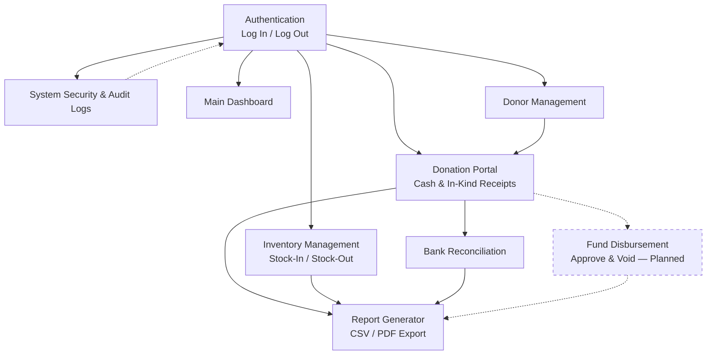

# Barangay Donation Management System
## Functional Requirements Specification

**Document Type:** Official Requirements Checklist & Defense Reference
**Status:** Living document — update the *Current Status* column as features are built or revised
**Last Reviewed Against Codebase:** 2026-07-30

---

### How to read this document

| Field | Meaning |
|---|---|
| **User Role** | Which side of the system owns the requirement — `Administrator` or `Staff` |
| **Priority** | `Critical` (system cannot ship without it), `High` (core to daily operations), `Medium` (valuable but not blocking) |
| **Current Status** | ✅ Implemented · 🟡 Partially Implemented · ⏳ Planned |
| **Related Module(s)** | The functional area(s)/codebase module(s) the requirement belongs to |
| **Notes** | Clarifications, scope caveats, or known limitations |

> **Role mapping note:** the current codebase implements three account roles — `admin`, `secretary`, and `treasurer` — enforced via the `role:admin,secretary,treasurer` route middleware and model policies. For this specification, **Administrator** corresponds to the `admin` role, and **Staff** corresponds to the `secretary` and `treasurer` roles collectively. Update this note if role names change.

> **Status accuracy:** statuses below were assessed by reviewing the current `routes/web.php`, controllers, services, models, migrations, and views. Re-verify before the defense if the codebase has changed since the review date above.

---

## Administrator

### 1. System & Account Control

| Feature Name | Description | User Role | Priority | Current Status | Related Module(s) | Notes |
|---|---|---|---|---|---|---|
| Log In | Authenticate with email and password to access the system. | Administrator | Critical | ✅ Implemented | Authentication (`AuthenticatedSessionController`) | Shared login flow for all roles; redirects by role after success. |
| Log Out | Terminate the active session securely. | Administrator | Critical | ✅ Implemented | Authentication (`AuthenticatedSessionController`) | Single shared logout route (`POST /logout`) for all authenticated roles. |
| Manage Staff Accounts | Create, view, edit, and deactivate Secretary/Treasurer accounts, and manage per-user security settings. | Administrator | High | 🟡 Partially Implemented | System Security (`SystemSecurityController`, `SystemSecurityDashboardQuery`) | Admin can currently **view** personnel and **toggle two-factor enforcement** per user. Account creation, editing, and deactivation from an admin UI were not found (only self-service `/register`). |
| Audit System Logs | View a searchable, filterable log of security-relevant actions across the system (logins, permission changes, etc.). | Administrator | High | ✅ Implemented | System Security (`SecurityActivityEvent`) | Includes action-type filter and free-text search, with actor/user attribution and IP address capture. |

### 2. Master Data & Cash Bookkeeping Management

| Feature Name | Description | User Role | Priority | Current Status | Related Module(s) | Notes |
|---|---|---|---|---|---|---|
| Manage Donor Records | Create, view, and update donor records (individuals/organizations) used across donations and reporting. | Administrator | Critical | ✅ Implemented | Donor Management (`DonorController`, `Donor`) | Full create/read/update flow with donor history and search. |
| Configure Item Categories | Define and maintain the list of in-kind item categories and units used in inventory intake. | Administrator | Medium | 🟡 Partially Implemented | Inventory Management (`config/inventory.php`) | Categories/units are a curated, hardcoded list (22 categories, 14 units) consumed throughout inventory forms and validation. There is no admin-facing UI to add/edit/remove categories at runtime. |
| Approve Fund Disbursements | Review and approve outgoing cash disbursement requests before funds are released. | Administrator | High | ⏳ Planned | Cash Bookkeeping | No disbursement/approval workflow, model, or route exists yet. Current cash flow only records inbound donations (`Contribution`, `CashTransaction`). |
| Reconcile Cash Ledger | Match bank statement entries against recorded contributions and mark them reconciled. | Administrator | Critical | ✅ Implemented | Bank Reconciliation (`BankReconciliationController`, `LedgerMatchFinder`, `ReconcileLedgerEntry`) | Includes ledger-entry matching, reconciliation status tracking, and an audit banner in the UI. |
| Void Cash Transactions | Reverse or cancel an erroneously recorded cash transaction while preserving an audit trail. | Administrator | High | ⏳ Planned | Cash Bookkeeping | No void/cancel/reversal action exists on `CashTransaction` or `Contribution` models or controllers. |

### 3. Intelligence & Reporting

| Feature Name | Description | User Role | Priority | Current Status | Related Module(s) | Notes |
|---|---|---|---|---|---|---|
| Access Main Dashboard | View a summary dashboard of key donation, inventory, and cash metrics. | Administrator | High | ✅ Implemented | Dashboard (`DashboardController`) | Includes stat summaries, activity list, and panel components. |
| Generate Financial Reports | Produce structured financial reports (currently: Financial Ledgers) filterable by year/month. | Administrator | Critical | ✅ Implemented | Report Generator (`ReportController`, `FinancialLedgerReportBuilder`) | Financial Ledgers report is live. Additional report types (e.g., inventory valuation, donor giving summaries) are not yet built. |
| Export PDF Files | Export any generated report as a downloadable PDF document. | Administrator | Medium | ⏳ Planned | Report Generator | Only **CSV** export exists today (`reports.financial-ledgers.csv`). No PDF rendering library (e.g., dompdf) is present in `composer.json`. |

---

## Staff

### 1. Session Management

| Feature Name | Description | User Role | Priority | Current Status | Related Module(s) | Notes |
|---|---|---|---|---|---|---|
| Log In | Authenticate with email and password to access the system. | Staff | Critical | ✅ Implemented | Authentication (`AuthenticatedSessionController`) | Same shared login flow as Administrator; access scope is enforced by role middleware/policies. |
| Log Out | Terminate the active session securely. | Staff | Critical | ✅ Implemented | Authentication (`AuthenticatedSessionController`) | Shared logout route. |

### 2. Operations & Cash Bookkeeping Entry

| Feature Name | Description | User Role | Priority | Current Status | Related Module(s) | Notes |
|---|---|---|---|---|---|---|
| Search Donor Database | Search existing donor records by name or other identifying details. | Staff | High | ✅ Implemented | Donor Management (`DonorController`) | Search bar component wired to donor index query. |
| View Donor Profiles | View a donor's full profile, including contribution history. | Staff | High | ✅ Implemented | Donor Management (`DonorController::show`) | Includes a donor history summary component. |
| Record Cash Receipts | Log an incoming cash donation against a donor, with verification workflow. | Staff | Critical | ✅ Implemented | Donation Portal (`DonationPortalController`, `Contribution`) | Includes `store`, `update`, and `verify` actions; a simpler legacy cash-entry form also exists under Role Workflows. |
| Record Cash Disbursements | Log an outgoing cash disbursement (e.g., aid payout, operational expense). | Staff | High | ⏳ Planned | Cash Bookkeeping | No outbound/disbursement transaction type exists; current `cash_transactions` and `contributions` schemas only model inbound donations. |

### 3. Warehouse & Distribution Execution

| Feature Name | Description | User Role | Priority | Current Status | Related Module(s) | Notes |
|---|---|---|---|---|---|---|
| Process Stock-In | Record incoming in-kind donations into inventory. | Staff | Critical | ✅ Implemented | Inventory Management (`InventoryStockAdjustmentController`, `movement_types.stock_in`) | Implemented via the stock adjustment endpoint with `stock_in` movement type. |
| Process Stock-Out | Record outgoing inventory for distribution to beneficiaries. | Staff | Critical | ✅ Implemented | Inventory Management (`InventoryStockAdjustmentController`, `movement_types.stock_out`) | Implemented via the same stock adjustment endpoint with `stock_out` movement type and a `distribution` adjustment reason. |
| Monitor Live Stock | View real-time stock levels, low-stock/critical-stock alerts, and expiring-item warnings. | Staff | High | ✅ Implemented | Inventory Management (`InventoryAlertQuery`, stock status config) | Stock status thresholds (adequate/low/critical/out-of-stock/expired) are config-driven. |

### 4. Basic Reporting & Bookkeeping View

| Feature Name | Description | User Role | Priority | Current Status | Related Module(s) | Notes |
|---|---|---|---|---|---|---|
| View Cash Ledger Logs | View recorded cash transactions and financial ledger entries (read-only). | Staff | Medium | ✅ Implemented | Report Generator / Bank Reconciliation | Available through the Financial Ledgers report view and bank ledger entry listings. |
| View Inventory Logs | View the history of stock movements for an inventory item. | Staff | Medium | ✅ Implemented | Inventory Management (`InventoryStockMovement`) | Displayed on the inventory item detail page. |
| Download PDF Reports | Download any viewable report as a PDF file. | Staff | Medium | ⏳ Planned | Report Generator | Depends on the same PDF export capability listed under Administrator → Export PDF Files. |

---

## Functional Requirement Summary Table

| # | Feature | Role | Priority | Status |
|---|---|---|---|---|
| A1 | Log In | Administrator | Critical | ✅ |
| A2 | Log Out | Administrator | Critical | ✅ |
| A3 | Manage Staff Accounts | Administrator | High | 🟡 |
| A4 | Audit System Logs | Administrator | High | ✅ |
| A5 | Manage Donor Records | Administrator | Critical | ✅ |
| A6 | Configure Item Categories | Administrator | Medium | 🟡 |
| A7 | Approve Fund Disbursements | Administrator | High | ⏳ |
| A8 | Reconcile Cash Ledger | Administrator | Critical | ✅ |
| A9 | Void Cash Transactions | Administrator | High | ⏳ |
| A10 | Access Main Dashboard | Administrator | High | ✅ |
| A11 | Generate Financial Reports | Administrator | Critical | ✅ |
| A12 | Export PDF Files | Administrator | Medium | ⏳ |
| S1 | Log In | Staff | Critical | ✅ |
| S2 | Log Out | Staff | Critical | ✅ |
| S3 | Search Donor Database | Staff | High | ✅ |
| S4 | View Donor Profiles | Staff | High | ✅ |
| S5 | Record Cash Receipts | Staff | Critical | ✅ |
| S6 | Record Cash Disbursements | Staff | High | ⏳ |
| S7 | Process Stock-In | Staff | Critical | ✅ |
| S8 | Process Stock-Out | Staff | Critical | ✅ |
| S9 | Monitor Live Stock | Staff | High | ✅ |
| S10 | View Cash Ledger Logs | Staff | Medium | ✅ |
| S11 | View Inventory Logs | Staff | Medium | ✅ |
| S12 | Download PDF Reports | Staff | Medium | ⏳ |

**Totals:** 24 requirements — 17 ✅ Implemented, 2 🟡 Partially Implemented, 5 ⏳ Planned.

---

## Administrator Feature Matrix

| Module | Implemented | Partially Implemented | Planned |
|---|---|---|---|
| System & Account Control | Log In, Log Out, Audit System Logs | Manage Staff Accounts | — |
| Master Data & Cash Bookkeeping Management | Manage Donor Records, Reconcile Cash Ledger | Configure Item Categories | Approve Fund Disbursements, Void Cash Transactions |
| Intelligence & Reporting | Access Main Dashboard, Generate Financial Reports | — | Export PDF Files |

## Staff Feature Matrix

| Module | Implemented | Partially Implemented | Planned |
|---|---|---|---|
| Session Management | Log In, Log Out | — | — |
| Operations & Cash Bookkeeping Entry | Search Donor Database, View Donor Profiles, Record Cash Receipts | — | Record Cash Disbursements |
| Warehouse & Distribution Execution | Process Stock-In, Process Stock-Out, Monitor Live Stock | — | — |
| Basic Reporting & Bookkeeping View | View Cash Ledger Logs, View Inventory Logs | — | Download PDF Reports |

---

## Module Dependency Diagram

*Dashed lines indicate dependencies on the planned Fund Disbursement capability, which is not yet implemented.*

---

## Recommended Implementation Order

1. **Foundation (done):** Authentication, role-based access, main dashboard.
2. **Core records (done):** Donor management, donation portal (cash & in-kind receipts with verification).
3. **Warehouse operations (done):** Inventory item management, stock-in/stock-out adjustments, live stock monitoring.
4. **Cash oversight (done):** Bank reconciliation and financial ledger reporting (CSV export).
5. **Administrative account control (next priority):** Full staff account lifecycle management — create, edit, deactivate accounts, and assign roles/permissions from an admin UI.
6. **Cash bookkeeping completeness (next priority):** Cash disbursement recording, disbursement approval workflow, and void/reversal of cash transactions with audit trail.
7. **Reporting completeness:** PDF export for all report types and downloadable PDF reports for Staff.
8. **Master data configurability:** Admin UI for managing item categories/units instead of static config.

---

## Future Enhancements

- PDF export/download for all reports (Financial Ledgers and future report types).
- Admin-managed staff account lifecycle (create, edit, deactivate, role/permission assignment).
- Cash disbursement recording and an approval workflow (maker-checker) for outgoing funds.
- Void/reversal of cash transactions with a preserved audit trail (no hard deletes).
- Admin-configurable item categories and units (replacing the static config list).
- Additional report types (e.g., donor giving summaries, inventory valuation, distribution impact reports).
- Notification system for low-stock alerts and pending approvals.

---

## Acceptance Criteria

**System & Account Control**
- Given valid credentials, a user can log in and is routed to the dashboard appropriate to their role.
- Given an active session, a user can log out and is immediately denied access to protected routes.
- Given an Administrator, they can view all staff accounts, their roles, and 2FA enforcement status.
- Given a security-relevant action occurs (login, permission change, etc.), an audit log entry is created with actor, action, and timestamp.

**Master Data & Cash Bookkeeping Management**
- Given a donor's details, an Administrator can create and later update the donor record.
- Given a bank statement entry, an Administrator can match it to a recorded contribution and mark it reconciled.
- *(Planned)* Given a disbursement request, an Administrator can approve or reject it before funds are recorded as disbursed.
- *(Planned)* Given an erroneous cash transaction, an Administrator can void it without deleting the underlying record.

**Intelligence & Reporting**
- Given a selected month/year, the system generates a Financial Ledgers report showing all matching transactions.
- Given a generated report, a user can export it as CSV.
- *(Planned)* Given a generated report, a user can export/download it as PDF.

**Operations & Warehouse Execution**
- Given a donor search term, Staff can find matching donor records.
- Given a valid cash donation, Staff can record it and it appears pending verification.
- Given incoming in-kind goods, Staff can record a stock-in movement that increases item quantity.
- Given outgoing goods for distribution, Staff can record a stock-out movement that decreases item quantity and cannot exceed available stock.
- Given current stock levels, Staff can view items flagged as low, critical, out-of-stock, or expiring soon.

---

## Defense Checklist

- [ ] Confirm the *Current Status* column above still matches the deployed codebase (re-run through routes/controllers if time has passed since last review).
- [ ] Prepare a live demo path: Log in → Dashboard → Record a donation → Verify it → Stock-in/stock-out an item → Reconcile a ledger entry → Generate a Financial Ledgers report → Export CSV.
- [ ] Be ready to explain the three implementation roles (`admin`, `secretary`, `treasurer`) and how they map to the Administrator/Staff terminology used in this document.
- [ ] Be ready to explicitly state which requirements are **Planned**, and why (scope prioritization, time constraints): Approve Fund Disbursements, Void Cash Transactions, Record Cash Disbursements, PDF export (both roles).
- [ ] Be ready to explain the **Partially Implemented** items: Manage Staff Accounts (view + 2FA toggle only, no full CRUD) and Configure Item Categories (static config, not admin-editable).
- [ ] Verify test coverage referenced in `tests/Feature/` (Bank Reconciliation, Donation Management, Inventory Management, Financial Ledger Report Builder, Report Generator, System Security Administration, Registration) passes before the defense.
- [ ] Have this document available as the panel's reference for scope — do not claim features beyond what is marked ✅ Implemented.
