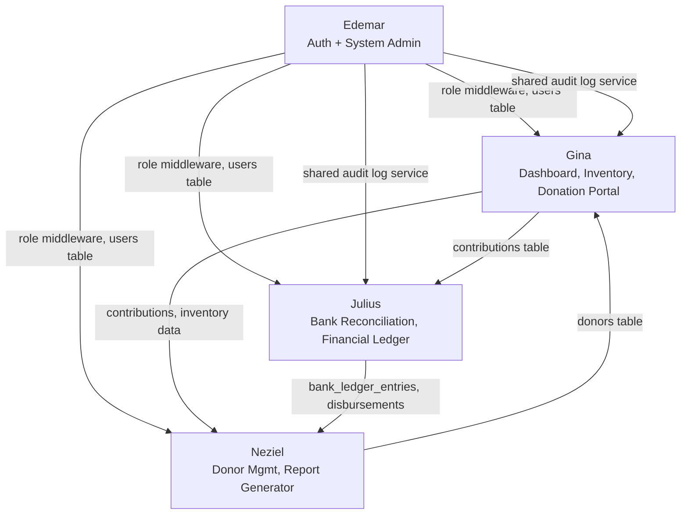

# Barangay Donation Management System
## Team Task Assignment

**Document Type:** Official Task Allocation & Defense Reference
**Status:** Living document — update checklists as tasks are completed
**Source of Truth:** [`docs/PROJECT_REQUIREMENTS.md`](./PROJECT_REQUIREMENTS.md) (Functional Requirements Specification, last reviewed 2026-08-02)
**Team:** Gina, Neziel, Julius, Edemar

---

### How to read this document

Each member section lists concrete, actionable tasks derived from the functional requirements already assigned to their modules. Tasks marked **(done)** reflect work already present in the codebase as of the last requirements review — verify before claiming credit in defense. Tasks with no marker are outstanding work needed to close the gaps identified in the requirements doc (🟡 Partially Implemented / ⏳ Planned items).

| Status Marker | Meaning |
|---|---|
| **(done)** | Implemented in the current codebase |
| *(no marker)* | Outstanding — needs to be built |

---

## Gina — Dashboard, In-Kind Inventory, Donation Portal

### Overview
Gina owns the three modules that carry the system's day-to-day operational core: the at-a-glance Dashboard, the in-kind warehouse workflow (stock-in/stock-out/monitoring), and the Donation Portal where cash and in-kind gifts are logged and verified.

### Responsibilities
- Keep the Dashboard's summary metrics accurate as new data sources (disbursements, void transactions) come online.
- Own the full lifecycle of an inventory item: creation, stock movement, alerting, and history.
- Own the full lifecycle of a contribution: intake, verification, and status tracking for both cash and in-kind gifts.

### Features
| Feature | Related Requirement(s) | Status |
|---|---|---|
| Access Main Dashboard | A10 | ✅ done |
| Process Stock-In | S7 | ✅ done |
| Process Stock-Out | S8 | ✅ done |
| Monitor Live Stock (low/critical/expiring alerts) | S9 | ✅ done |
| View Inventory Logs (movement history) | S11 | ✅ done |
| Configure Item Categories (admin-editable) | A6 | ✅ done |
| Record Cash Receipts (Donation Portal) | S5 | ✅ done |
| Record Cash Disbursements | S6 | ✅ done (via Julius's canonical Disbursements module — see below; Gina's original standalone implementation was removed as a duplicate) |

### Database Tables Used
- `inventory_items` — item master data, quantity, unit, thresholds
- `inventory_stock_movements` — stock-in/stock-out audit trail (`movement_type`, `quantity_before/after`, `reason`, `created_by`)
- `contributions` — cash and in-kind donation records (`type`, `status`, `amount`, `payment_method`, `verified_by`, `verified_at`)
- `contribution_items` — line items for in-kind contributions (links to `inventory_items`)
- `donors` — read dependency for donation intake (owned by Neziel, consumed here)
- `campaigns` — optional grouping for contributions
- `inventory_categories`, `inventory_units` — admin-managed reference data replacing `config/inventory.php` (A6)
- `cash_disbursements` — now owned entirely by **Julius** (request → approve/reject → void workflow with maker-checker and audit trail). Gina's original standalone schema/controller for this table was removed and superseded — see Julius's section below.

### Backend Tasks
- [ ] **(done)** `DashboardController` — aggregate stat summaries, activity feed, panel data
- [ ] **(done)** `InventoryController` — CRUD for `InventoryItem` (`index`, `store`, `show`, `update`)
- [ ] **(done)** `InventoryStockAdjustmentController` — stock-in/stock-out adjustment endpoint
- [ ] **(done)** `AdjustInventoryStock` service — quantity math, movement logging, stock-out cannot exceed available stock
- [ ] **(done)** `CreateInventoryItem` service
- [ ] **(done)** `InventoryAlertQuery` service — low/critical/out-of-stock/expiring computation
- [ ] **(done)** `DonationPortalController` — `index`, `store`, `show`, `update`, `verify`
- [ ] **(done)** `LogContribution` service — creates `Contribution` + `ContributionItem` rows
- [ ] **(done)** `InventoryItemPolicy`, `ContributionPolicy` — authorization rules
- [x] Add `inventory_categories`/`inventory_units` tables, models, policies, `ManageInventoryReferenceItem` service, and CRUD controllers/routes; update `InventoryItem` validation and search to read from the database instead of `config/inventory.php` (closes A6)
- [x] ~~Design and build cash disbursement recording endpoint (`CashDisbursementController`, `cash_disbursements` table, `RecordCashDisbursement` service)~~ — **removed.** This standalone implementation (no approval/status columns) was a duplicate of Julius's later, canonical request/approve/reject/void workflow and has been deleted from the codebase (controller, request classes, service, old migration, views, test).
- [x] `DashboardMetrics` disbursement widgets read Julius's live `cash_disbursements` schema directly (`CashDisbursement::query()->where('status', 'approved')->whereNull('voided_at')->sum('amount')`) — confirmed compatible with the current schema, no adaptation needed
- [x] Repoint `DashboardMetrics` off the orphaned pre-Donation-Portal tables (`cash_transactions`, `donations`, `bank_reconciliations` — none written to by any current feature) onto the live schema: cash/pending totals and funding distribution now read `contributions`, reconciliation status reads Julius's `bank_ledger_entries`, and the activity feed drops the dead tables in favor of `contributions`/`inventory_items`/`cash_disbursements`
- [x] Removed the dead legacy `/role-workflows` page — `DonationController` (unrouted, wrote directly to the orphaned `Donation` model), `InventoryCashController` (wrote directly to `CashTransaction`, bypassing inventory stock-movement logging), `role-workflows.blade.php`, and the "Financial Ledger" sidebar entry pointing at it. This was leftover prototype scaffolding that predates the Donation Portal/Inventory modules and is unrelated to Julius's canonical Disbursements module (`disbursements.index`), which remains in the sidebar as "Fund Disbursements"

### Frontend Tasks
- [ ] **(done)** `dashboard.blade.php` + `components/dashboard/*` (panel, stat-list, activity-list, summary-card, empty/error states)
- [ ] **(done)** `inventory/index.blade.php`, `inventory/show.blade.php`
- [ ] **(done)** `components/inventory/*` — filter tabs, search bar, status badge, stock summary, alert panel, table/table-row, create modal, item form, adjust-stock modal
- [ ] **(done)** `donations/index.blade.php`, `donations/show.blade.php`
- [ ] **(done)** `components/donations/*` — status badge, filter bar, table/table-row, cash-fields, in-kind-fields, item-row, log-modal
- [x] Build admin-facing "Manage Item Categories" screen (add/edit/remove category + unit) to replace static config
- [x] ~~Build "Record Disbursement" form/modal — new "Cash Disbursements" page and sidebar entry~~ — **removed**, superseded by Julius's `disbursements/index.blade.php` (request form + approve/reject/void actions in one maker-checker page)

### API Endpoints Needed
| Method | Route | Purpose | Status |
|---|---|---|---|
| GET | `/` | Dashboard | ✅ done |
| GET | `/inventory` | List inventory items | ✅ done |
| POST | `/inventory` | Create inventory item | ✅ done |
| GET | `/inventory/{inventoryItem}` | Item detail + movement history | ✅ done |
| PATCH | `/inventory/{inventoryItem}` | Update item | ✅ done |
| POST | `/inventory/{inventoryItem}/adjustments` | Stock-in/stock-out | ✅ done |
| GET | `/donations` | List contributions | ✅ done |
| POST | `/donations` | Record cash/in-kind donation | ✅ done |
| GET | `/donations/{contribution}` | Donation detail | ✅ done |
| PATCH | `/donations/{contribution}` | Update donation | ✅ done |
| PATCH | `/donations/{contribution}/verify` | Verify donation | ✅ done |
| GET/POST/PATCH/DELETE | `/inventory/categories`, `/inventory/units` | CRUD item categories/units (admin-only mutations) | ✅ done |
| GET/POST/PATCH | `/disbursements`, `/disbursements/{disbursement}/approve\|reject\|void`, `/contributions/{contribution}/void` | Request/approve/reject/void disbursements — Julius's canonical implementation, replaces Gina's removed `/cash-disbursements` endpoints | ✅ done — see Julius's section |

### Validation Rules
- Stock-out quantity must not exceed current `quantity_before` (enforced in `AdjustInventoryStock`).
- `movement_type` restricted to `stock_in` / `stock_out`; `reason` restricted to a known set (e.g., `distribution`).
- Contribution `type` restricted to `cash` / `in_kind`; `amount` required when `type = cash`; `contribution_items` required when `type = in_kind`.
- `payment_method` + `reference_number` combination must be unique per the DB constraint on `contributions`.
- Category/unit `key` must be unique and non-empty, enforced via `inventory_categories`/`inventory_units` unique constraints and Form Request validation (done).
- Disbursement amount must be positive (`min:0.01`); a balance-ceiling check against available cash was deliberately deferred — no authoritative balance source exists yet pending Julius's Financial Ledger integration.

### Dependencies
- Consumes `donors` records owned by **Neziel** (Donor Management) for donation intake.
- Feeds contribution and inventory data into **Neziel's** Report Generator (Financial Ledgers, future inventory reports).
- Feeds contribution data into **Julius's** Bank Reconciliation and Financial Ledger modules.
- Cash disbursement recording is now fully owned by **Julius** — Gina's original standalone implementation was removed in favor of his canonical request/approve/reject/void workflow, which is directly consumed by the Financial Ledger report.
- Relies on **Edemar's** authentication/role middleware (`role:admin,secretary,treasurer`) to gate all routes.

### Testing Checklist
- [ ] **(done)** `tests/Feature/InventoryManagementTest.php` — stock-in/out, thresholds, validation
- [ ] **(done)** `tests/Feature/DonationManagementTest.php` — cash/in-kind intake, verification flow
- [x] Add feature test for admin category management once built — `tests/Feature/InventoryCategoryManagementTest.php`
- [x] ~~Add feature test for cash disbursement recording once built — `tests/Feature/CashDisbursementTest.php`~~ — **removed** along with the standalone feature; disbursement workflow testing now lives in Julius's `tests/Feature/DisbursementWorkflowTest.php`
- [x] Dashboard widget test asserting stat totals match underlying data — `test_dashboard_reflects_recorded_disbursement_totals` (reads Julius's current schema; implemented but not locally re-verified after the Neziel/Julius merge — PHP/Composer unavailable locally)
- [x] Add regression coverage for the dashboard data-source fix — `tests/Feature/DashboardMetricsTest.php` (verified-only cash totals, campaign funding distribution, cash+in-kind recent donations, bank-ledger reconciliation state, and an explicit test that legacy `cash_transactions`/`donations` rows no longer affect dashboard totals)

### Documentation Required
- [x] Inventory stock movement lifecycle diagram (stock-in → alert thresholds → stock-out) — [`docs/inventory-stock-lifecycle.md`](./inventory-stock-lifecycle.md)
- [x] Donation Portal intake-to-verification flow diagram (cash vs in-kind branches) — [`docs/donation-portal-flow.md`](./donation-portal-flow.md)
- [x] Dashboard widget data-source reference (which query backs each stat/panel) — [`docs/dashboard-data-sources.md`](./dashboard-data-sources.md)
- [x] Category management admin guide — [`docs/category-management-admin-guide.md`](./category-management-admin-guide.md)

### Deliverables
- Fully functional Dashboard reflecting live donation, inventory, and cash metrics
- In-Kind Inventory module: item CRUD, stock-in/out, live alerts, movement history
- Donation Portal: cash + in-kind intake with verification workflow
- Admin-manageable item categories (closes A6)
- Cash disbursement recording (closes S6) — now fulfilled entirely by Julius's canonical Disbursements module; Gina's original standalone implementation was removed as a duplicate

### Estimated Priority
- **Critical:** Donation Portal (S5), Stock-In/Stock-Out (S7/S8), Dashboard (A10)
- **High:** Monitor Live Stock (S9), Cash Disbursements (S6)
- **Medium:** Configure Item Categories (A6)

### Completion Checklist
- [x] Dashboard summary widgets
- [x] Inventory item CRUD
- [x] Stock-in / stock-out adjustment flow
- [x] Live stock alerts (low/critical/expiring)
- [x] Inventory movement history view
- [x] Donation Portal cash intake
- [x] Donation Portal in-kind intake
- [x] Donation verification workflow
- [x] Admin-managed item categories/units (A6)
- [x] Cash disbursement recording (S6) — fulfilled via Julius's canonical Disbursements module (Gina's original standalone version removed)
- [x] Dashboard widgets updated for disbursement data
- [x] New feature tests for above

---

## Neziel — Donation Management, Report Generator

### Overview
Neziel owns donor-facing records (the "who" behind every donation) and the reporting layer that turns raw contribution/inventory/ledger data into structured, exportable reports for the Administrator.

### Responsibilities
- Maintain accurate, searchable donor records and donation history.
- Build and extend the Report Generator: report types, filters, and export formats.

### Features
| Feature | Related Requirement(s) | Status |
|---|---|---|
| Manage Donor Records (create/view/update) | A5 | ✅ done |
| Search Donor Database | S3 | ✅ done |
| View Donor Profiles + history | S4 | ✅ done |
| Generate Financial Reports (Financial Ledgers) | A11 | ✅ done |
| View Cash Ledger Logs | S10 | ✅ done |
| CSV Export | (supports A11) | ✅ done |
| Donor Giving Summary (Philanthropy Roster tab) | Future Enhancements | ✅ implemented but not locally verified yet |
| Export PDF Files | A12 | ⏳ outstanding |
| Download PDF Reports (Staff) | S12 | ⏳ outstanding |
| Additional report types (inventory valuation) | Future Enhancements | ⏳ outstanding |

### Database Tables Used
- `donors` — donor master data (individuals/organizations)
- `contributions` / `contribution_items` — read dependency for donation history, the Financial Ledgers report, and (new) the Donor Giving Summary report (`contribution_items.estimated_value` sums in-kind totals per donor, since `contributions.amount` is `null` for in-kind rows)
- `campaigns` — optional grouping context
- `bank_ledger_entries` — read dependency (Julius's module) for ledger-based reports
- `cash_disbursements` — read dependency (Julius's module); already consumed by `FinancialLedgerReportBuilder`

### Backend Tasks
- [x] **(done)** `DonorController` — `index` (with search), `store`, `show`, `update`
- [x] **(done)** `FinancialLedgerReportBuilder` service — assembles ledger data filterable by year/month
- [x] **(done)** `FinancialLedgerCsvExporter` service
- [x] **(done)** `ReportController` — `index`, `financialLedgersCsv`
- [x] **(implemented but not locally verified yet)** `DonorGivingSummaryReportBuilder` service — per-donor aggregates (contribution count, cash total, in-kind total via `contribution_items.estimated_value`, combined value, first/last gift date); excludes cancelled/voided contributions to stay consistent with `FinancialLedgerReportBuilder`'s rules; supports search + 4 sort modes (`highest`, `lowest`, `most_contributions`, `latest`)
- [x] **(implemented but not locally verified yet)** `ReportController::index` extended to build the donor summary when `tab === 'philanthropy-roster'` — reuses the existing route/action rather than adding a new one
- [x] **(implemented but not locally verified yet)** `ReportIndexRequest` extended with `search`/`sort` validation rules and accessors
- [x] Fixed `Donor::scopeWithDonationMetrics()` and `DonorController::show()` — both still read the orphaned `Donation` model (`donations()` relation, `donation_type`/`description` columns), so donor cards and donor-profile "Donation History" never reflected real contributions logged through the Donation Portal. Repointed to the `contributions` relation (`type`, `notes`), excluding voided contributions from the count/totals via `whereNull('voided_at')`; `donors/show.blade.php` updated to match and now shows a "Voided" badge per row. `tests/Feature/DonationManagementTest.php::test_donor_history_shows_only_selected_donor_donations` rewritten to create `Contribution` rows instead of `Donation` rows
- [ ] Add PDF export capability: introduce a PDF rendering library (e.g., `barryvdh/laravel-dompdf`) to `composer.json` — **outstanding**, not present in `composer.json`
- [ ] Build `FinancialLedgerPdfExporter` (or generalized `ReportPdfExporter`) mirroring the CSV exporter's structure — **outstanding**, no such class exists in `app/Services/Reports`
- [ ] Add `ReportController::financialLedgersPdf` (or generic `{report}/pdf`) endpoint — **outstanding**, no PDF route exists in `routes/web.php`
- [x] ~~Design and build at least one additional report builder (e.g., Donor Giving Summary)~~ — **done**, see `DonorGivingSummaryReportBuilder` above
- [ ] Add donor deduplication/merge safeguard (validation-level, not full feature) if duplicate donor entries are a defense concern — still outstanding
- [ ] Additional report types beyond Donor Giving Summary (e.g. inventory valuation) — still outstanding, no code found

### Frontend Tasks
- [x] **(done)** `donors/index.blade.php`, `donors/show.blade.php`
- [x] **(done)** `components/donors/*` — search-bar, form, create-modal, edit-modal, card, history-summary
- [x] **(done)** `reports/index.blade.php`
- [x] **(done)** `components/reports/*` — tab-nav, month-filter, wire-source-bar, ledger-row
- [x] **(implemented but not locally verified yet)** `resources/views/reports/partials/donor-giving-summary.blade.php` — filter form (search/month/year/sort) + results table, rendered through the existing **Philanthropy Roster** tab
- [ ] Add "Download PDF" button/action to the Report Generator UI (Financial Ledgers tab) — **outstanding**, no PDF button exists
- [x] ~~Add new tab(s) to `reports/index.blade.php` for each new report type~~ — **not needed for Donor Giving Summary.** It reuses the existing **Philanthropy Roster** tab (previously a "coming soon" placeholder) instead of adding a new tab — matches the original design doc's stated plan to reuse the same `ReportController`/tab pattern for follow-up reports (`docs/superpowers/specs/2026-07-25-report-generator-design.md`). Documented here as "Philanthropy Roster / Donor Giving Summary," not as a separate tab. "In-Kind Audits" remains a "coming soon" placeholder.
- [ ] Surface donor giving history totals on `donors/show.blade.php` if not already summarized — still outstanding; Donor Giving Summary lives on the Reports page, not the donor profile page

### API Endpoints Needed
| Method | Route | Purpose | Status |
|---|---|---|---|
| GET | `/donors` | List/search donors | ✅ done |
| POST | `/donors` | Create donor | ✅ done |
| GET | `/donors/{donor}` | Donor profile + history | ✅ done |
| PATCH | `/donors/{donor}` | Update donor | ✅ done |
| GET | `/reports` | Report Generator index (all tabs, incl. `?tab=philanthropy-roster`) | ✅ done |
| GET | `/reports/financial-ledgers/csv` | CSV export | ✅ done |
| GET | `/reports?tab=philanthropy-roster` | Donor Giving Summary — no new route; reuses `reports.index` with `search`/`sort`/`year`/`month` query params | ✅ implemented but not locally verified yet |
| GET | `/reports/financial-ledgers/pdf` (new) | PDF export | outstanding |
| GET | `/reports/{report-type}` (new) | Additional report types (e.g. inventory valuation) | outstanding |

### Validation Rules
- Donor name required; contact fields validated per format (email/phone) if collected.
- Donor `payment_method` + `reference_number` referenced from `contributions` must satisfy the existing unique constraint.
- Report filters: year/month must resolve to a valid date range; reject empty result sets gracefully (empty state, not error).
- Donor Giving Summary: `sort` restricted to `highest`/`lowest`/`most_contributions`/`latest` (`ReportIndexRequest`); cancelled and voided contributions are excluded from totals; donors with zero giving in the selected period are excluded from the roster rather than shown as zero-value rows.
- PDF export (once built): reuse the same filtered dataset as the CSV export to guarantee parity between formats — not yet applicable, no PDF exporter exists.

### Dependencies
- Donor records are a prerequisite for **Gina's** Donation Portal (a contribution always references a `donor_id`).
- Financial Ledgers report reads `contributions` (Gina), `cash_disbursements`/`bank_ledger_entries` (Julius) — confirmed the report builder already consumes Julius's canonical disbursement/reconciliation data.
- Donor Giving Summary reads `contributions` + `contribution_items` (Gina) — confirmed compatible with the live schema. This fixed a stale assumption inherited from an earlier WIP draft, which used `'in-kind'` instead of the real `'in_kind'` type value, and treated in-kind `amount` as populated when it is actually `null` on `contributions` for in-kind rows (the real value lives in `contribution_items.estimated_value`).
- PDF export is a shared capability also needed by **Julius** (Financial Ledger/Bank Reconciliation reports) — coordinate the library choice and exporter interface once, reuse across both. Still outstanding for both.
- Relies on **Edemar's** role middleware for route access.

### Testing Checklist
- [x] **(done)** `tests/Feature/FinancialLedgerReportBuilderTest.php`
- [x] **(done, updated)** `tests/Feature/ReportGeneratorTest.php` — `test_philanthropy_roster_tab_renders_a_coming_soon_placeholder` replaced with `test_philanthropy_roster_tab_renders_the_donor_giving_summary` and `test_philanthropy_roster_tab_shows_empty_state_with_no_giving`, since the tab no longer shows a placeholder
- [x] **(implemented but not locally verified yet)** `tests/Feature/DonorGivingSummaryReportTest.php` — covers guest redirect, cash+in-kind totals per donor, exclusion of cancelled/voided contributions, exclusion of zero-giving donors, sort options, search filter, and a full HTTP round-trip via the philanthropy-roster tab
- [ ] Add donor CRUD/search feature test if not already covered — not verified as part of this update
- [ ] Add PDF export feature test once built (assert content-type, byte signature, and row parity with CSV) — still outstanding, no exporter exists yet
- [x] ~~Add feature test for each new report type~~ — Donor Giving Summary covered; inventory valuation (or other future types) still outstanding

### Documentation Required
- [ ] Donor data model reference (fields, relationships to contributions) — still outstanding
- [x] Report Generator architecture doc (builder → exporter pattern, how to add a new report type) — [`docs/report-generator-architecture.md`](./report-generator-architecture.md) (copied in as reference material; describes the builder/exporter split this codebase already follows)
- [x] PDF export setup notes (library, fonts, layout constraints) — [`docs/pdf-export-setup.md`](./pdf-export-setup.md) (**reference only** — documents how to install/wire `barryvdh/laravel-dompdf` for when PDF export is actually built; the library is not installed and no PDF code exists yet)

### Deliverables
- Donor Management: full CRUD, search, profile with donation history (done)
- Report Generator: Financial Ledgers report with CSV export (done); Donor Giving Summary / Philanthropy Roster report (implemented but not locally verified yet); PDF export (outstanding — no library installed, no exporter, no route, no view); additional report types beyond Donor Giving Summary, e.g. inventory valuation (outstanding)

### Estimated Priority
- **Critical:** Manage Donor Records (A5), Generate Financial Reports (A11)
- **High:** Search/View Donor Profiles (S3/S4)
- **Medium:** View Cash Ledger Logs (S10), PDF Export (A12/S12), additional report types

### Completion Checklist
- [x] Donor CRUD (create/view/update)
- [x] Donor search
- [x] Donor profile with contribution history
- [x] Financial Ledgers report builder
- [x] CSV export
- [x] Donor Giving Summary report (Philanthropy Roster tab) — implemented but not locally verified yet
- [ ] PDF export library integration (`barryvdh/laravel-dompdf` not in `composer.json`)
- [ ] Financial Ledgers PDF export (A12/S12)
- [ ] Additional report type beyond Donor Giving Summary (e.g. inventory valuation)
- [x] Feature tests for Donor Giving Summary — implemented but not locally verified yet
- [ ] Feature tests for PDF export (not applicable yet, no exporter exists)

---

## Julius — Bank Reconciliation, Financial Ledger

### Overview
Julius owns the financial control layer: matching incoming bank entries against recorded donations, matching outgoing withdrawals against approved disbursements, and the cash bookkeeping lifecycle including requests, approvals, void/reversal, discrepancy handling, and finalized reconciliation with audit trail.

### Responsibilities
- Keep the reconciliation process accurate and auditable (match, mark reconciled, track status).
- Maintain the disbursement request, maker-checker approval/rejection, void/reversal, and outgoing reconciliation workflow.

### Features
| Feature | Related Requirement(s) | Status |
|---|---|---|
| Reconcile Cash Ledger | A8 | ✅ done |
| View Cash Ledger Logs (ledger entry listings) | S10 (shared with Neziel's report view) | ✅ done |
| Approve Fund Disbursements | A7 | ✅ implemented and covered by `tests/Feature/DisbursementWorkflowTest.php` |
| Void Cash Transactions | A9 | ✅ implemented and covered by `tests/Feature/DisbursementWorkflowTest.php` |
| Record Cash Disbursements (request/approve/reject/void, canonical) | S6 (now fully owned by Julius; Gina's earlier duplicate implementation removed) | ✅ implemented and tested |
| Outgoing Bank Reconciliation (match, discrepancy, finalize, history/details) | Task 4-7 workflow | ✅ implemented and covered by `tests/Feature/BankReconciliationTest.php` |

### Database Tables Used
- `bank_ledger_entries` — imported/recorded bank statement lines (`transaction_type`, `status`, incoming match fields, `discrepancy_amount`, `discrepancy_reason`, `reconciled_by`, `reconciled_at`)
- `bank_withdrawal_disbursement_matches` — many-to-one outgoing links from approved disbursements to a withdrawal, with uniqueness protection per disbursement
- `contributions` — matched against ledger entries (owned/populated by Gina's Donation Portal); now also carries `voided_at`/`voided_by`/`void_reason` for the void/reversal mechanism (migration `2026_08_23_000001_add_void_fields_to_contributions_table.php`)
- `cash_disbursements` — **implemented**: `amount`, `purpose`, `requested_by`, `approved_by`, `status`, `approved_at`, `rejected_at`, `rejection_reason`, `voided_at`, `voided_by`, `void_reason` (migration `2026_08_23_000002_create_cash_disbursements_table.php`). This is the canonical schema — it replaced Gina's earlier standalone `cash_disbursements` table (no approval/status columns), which has been deleted along with her `CashDisbursementController`/`RecordCashDisbursement` service.

### Backend Tasks
- [x] **(done)** `BankReconciliationController` — `index`, `reconcile`
- [x] **(done)** `LedgerMatchFinder` service — candidate matching logic
- [x] **(done)** `ReconcileLedgerEntry` service — marks entry reconciled, links to contribution
- [x] **(done)** `LedgerChannelResolver` service — payment channel resolution
- [x] **(done)** `BankLedgerEntryPolicy` — authorization
- [x] `cash_disbursements` migration and canonical request/approval/void schema
- [x] `DisbursementController` — `index`, `store` (request), `approve`, `reject`, `voidDisbursement`, `voidContribution`
- [x] `RequestDisbursement`, `ApproveDisbursement`, `RejectDisbursement`, `VoidDisbursement`, and `VoidContribution` services
- [x] Maker-checker and void policies with audit events
- [x] `FinancialLedgerReportBuilder` consumes approved, non-voided disbursements
- [x] Outgoing reconciliation services, requests, migrations, history, details, and finalization metadata

### Frontend Tasks
- [x] **(done)** `bank-reconciliation.blade.php`
- [x] **(done)** `components/bank-reconciliation/*` — badge, receipt-card, match-modal, audit-banner, ledger-entry
- [x] `disbursements/index.blade.php` — request form, request history, status badges, and gated approval/rejection/void actions
- [x] Void actions wired into the UI for disbursements and eligible contributions
- [x] **(done)** Void/disbursement rows surface on the Financial Ledgers report view — `resources/views/reports/index.blade.php` renders unified `ledger` rows (`x-reports.ledger-row`) covering both contributions and disbursements, via `FinancialLedgerReportBuilder`

### API Endpoints Needed
| Method | Route | Purpose | Status |
|---|---|---|---|
| GET | `/bank-reconciliation` | List ledger entries + match candidates | ✅ done |
| POST | `/bank-reconciliation/reconcile` | Reconcile a ledger entry | ✅ done |
| GET | `/disbursements` | List disbursement requests | ✅ tested |
| POST | `/disbursements` | Request a cash disbursement | ✅ tested |
| PATCH | `/disbursements/{disbursement}/approve` | Approve disbursement | ✅ tested |
| PATCH | `/disbursements/{disbursement}/reject` | Reject disbursement | ✅ tested |
| PATCH | `/disbursements/{disbursement}/void` | Void an approved disbursement | ✅ tested |
| PATCH | `/contributions/{contribution}/void` | Void a pending, unreconciled cash contribution | ✅ tested |
| POST | `/bank-reconciliation/withdrawals` | Record a bank withdrawal | ✅ tested |
| POST | `/bank-reconciliation/withdrawals/{withdrawal}/matches` | Save approved disbursement matches and discrepancy data | ✅ tested |
| POST | `/bank-reconciliation/withdrawals/{withdrawal}/reconcile` | Finalize a balanced outgoing reconciliation | ✅ tested |
| GET | `/bank-reconciliation/withdrawals/{withdrawal}` | Read-only finalized withdrawal details | ✅ tested |

### Validation Rules
- A `bank_ledger_entries` row can match at most one `contribution` (existing unique constraint on `matched_contribution_id`).
- Reconciliation requires `status = unmatched` before allowing a match action.
- Disbursement amount must be positive and requires a `purpose` (enforced in `StoreDisbursementRequest`); approver must have `admin` role and cannot equal the requester (enforced in `ApproveDisbursement`, throws `ValidationException` if violated).
- Void action requires a `void_reason` (enforced in `VoidDisbursementRequest`/`VoidContributionRequest`); only `approved`, non-voided disbursements can be voided (`VoidDisbursement`), and only `pending`, unreconciled cash contributions can be voided (`ContributionPolicy::void` — checks `isCash()`, `status === 'pending'`, `! isVoided()`, and no linked `BankLedgerEntry`).
- Voided disbursements are excluded from active balance calculations: `FinancialLedgerReportBuilder` filters to `status === 'approved' && ! $disbursement->isVoided()` for `disbursement_total`, but voided/cancelled entries remain visible in the unified ledger rows with a "Voided" status label — audit history is preserved, not hidden.

### Dependencies
- Reconciliation depends on `contributions` created by **Gina's** Donation Portal.
- Disbursement and void data feed directly into **Neziel's** Financial Ledgers report — confirmed the report builder already reads `CashDisbursement` for both the disbursement total and the unified ledger rows.
- Void/disbursement actions log through **Edemar's** `security_activity_events` infrastructure (`disbursement_approved`, `disbursement_voided`, `contribution_voided` actions confirmed in the services).
- **Cash disbursement UI entry point (S6) is now fully owned by Julius.** Gina originally built a standalone recording page/controller/schema for S6 (no approval columns); once Julius's full request → approve/reject → void workflow landed with the superseding `cash_disbursements` schema, Gina's duplicate (`CashDisbursementController`, `RecordCashDisbursement`, the old migration, `cash-disbursements/*` views, `CashDisbursementTest`) was removed from the codebase as redundant. Julius's `DisbursementController` + `disbursements/index.blade.php` is the single, canonical implementation of S6 going forward.

### Testing Checklist
- [x] **(done)** `tests/Feature/BankReconciliationTest.php`
- [x] `tests/Feature/DisbursementWorkflowTest.php` — covers request/pending state, maker-checker approval/rejection, voiding, audit events, and approved active totals
- [x] `tests/Feature/BankReconciliationTest.php` — covers incoming reconciliation plus outgoing withdrawal creation/import, eligible matching, discrepancy handling, finalization locking, history, and details
- [x] `tests/Feature/DashboardMetricsTest.php` — covers live Treasurer Action Items counts and unresolved difference totals
- [ ] No dedicated regression test yet asserting `FinancialLedgerReportBuilder` totals correctly exclude voided/rejected disbursements from `disbursement_total` while still listing them in the ledger — state transitions and audit rows are covered by `DisbursementWorkflowTest`, but not report-total correctness end-to-end. Genuinely outstanding.

### Documentation Required
- [ ] Reconciliation matching algorithm reference (how `LedgerMatchFinder` scores candidates)
- [ ] Disbursement approval workflow diagram (maker-checker states)
- [ ] Void/reversal policy doc — what can be voided, by whom, and audit trail guarantees

### Deliverables
- Bank Reconciliation: incoming/outgoing ledger matching, discrepancy handling, finalization, history, and details (done)
- Fund Disbursement: request + approval/rejection workflow (closes A7) — done
- Void/Reversal: audit-preserving cash transaction voiding (closes A9) — done
- Updated Financial Ledger data model reflecting disbursements and voids — done
- Absorbed and superseded Gina's original standalone Cash Disbursement recording (S6) into this canonical module

### Estimated Priority
- **Critical:** Reconcile Cash Ledger (A8)
- **High:** Controlled correction/reversal process for already finalized reconciliations
- **Medium:** View Cash Ledger Logs (S10, shared)

### Completion Checklist
- [x] Bank ledger entry listing
- [x] Ledger-to-contribution matching
- [x] Reconciliation status tracking
- [x] Audit banner in reconciliation UI
- [x] `cash_disbursements` schema + migration
- [x] Disbursement request + approval workflow (A7)
- [x] Void/reversal mechanism with audit trail (A9)
- [x] Financial Ledgers report updated for disbursements/voids
- [x] Feature tests for disbursement and void flows — `tests/Feature/DisbursementWorkflowTest.php`
- [x] Outgoing reconciliation discrepancy/finalization/history workflow — `tests/Feature/BankReconciliationTest.php`
- [ ] Regression test confirming report totals correctly exclude voided/rejected disbursements — not yet written

---

## Edemar — Authentication (Sign In / Sign Up / Sign Out), System Administration

### Overview
Edemar owns the security perimeter of the system: authentication, session handling, role-based authorization, and the administrative tooling for managing staff accounts and auditing security-relevant activity.

### Responsibilities
- Ensure login/logout/registration are secure and correctly scoped by role.
- Close the gap between "view-only" staff administration and full account lifecycle management.
- Maintain the audit log and 2FA enforcement tooling.

### Features
| Feature | Related Requirement(s) | Status |
|---|---|---|
| Log In | A1 / S1 | ✅ done |
| Log Out | A2 / S2 | ✅ done |
| Audit System Logs | A4 | ✅ done |
| Manage Staff Accounts (view + 2FA toggle) | A3 | ✅ done |
| Manage Staff Accounts (full create/edit/deactivate CRUD) | A3 | ✅ done |

### Database Tables Used
- `users` — credentials, `first_name`, `last_name`, `status`, `last_login_at`, `role_id`
- `roles` — `admin`, `secretary`, `treasurer` (name, display_name, description)
- `security_permissions`, `security_permission_user` — granular permission grants
- `user_security_profiles` — 2FA enabled/enforced state, verification timestamp
- `security_activity_events` — audit log (actor, action, summary, metadata, IP, occurred_at)

### Backend Tasks
- [x] `Auth\AuthenticatedSessionController` — `create`, `store` (login), `destroy` (logout)
- [x] `Auth\RegisteredUserController` — `create`, `store` (self-service registration)
- [x] `role:admin,secretary,treasurer` route middleware
- [x] `SystemSecurityController` — `index`, `updateTwoFactorEnforcement`
- [x] `SystemSecurityDashboardQuery` service — personnel list, activity log query/filter
- [x] `ToggleTwoFactorEnforcement` service
- [x] `SecurityActivityEventPolicy`
- [x] Build `StaffAccountController` (or extend `SystemSecurityController`) — `store` (create staff account with role assignment), `update` (edit name/role/email), `deactivate` (soft-disable, sets `status`)
- [x] Build `CreateStaffAccount` / `UpdateStaffAccount` / `DeactivateStaffAccount` services following existing service-class pattern
- [x] Gate account creation/edit/deactivation behind `admin`-only authorization (extend or add a policy)
- [x] Ensure every account lifecycle action (create/edit/deactivate) writes a `security_activity_events` row for auditability
- [ ] Review self-service `/register` — confirm whether it should remain open or be restricted once admin-driven account creation exists (scope decision, flag for defense Q&A)

### Frontend Tasks
- [x] `auth/login.blade.php`, `auth/register.blade.php`, `layouts/guest.blade.php`
- [x] `system-security.blade.php`
- [x] `components/system-security/*` — status-badge, section-header, permission-checklist, filter-dropdown, search-bar, activity-log-row, user-security-card
- [x] Build "Create Staff Account" modal/form (name, email, role selection, initial password/invite flow)
- [x] Build "Edit Staff Account" modal (name, role, status)
- [x] Build "Deactivate Account" confirmation action + disabled-state styling on `user-security-card`
- [ ] Add role/permission assignment UI if per-user granular permissions (`security_permissions`) are to be admin-editable

### API Endpoints Needed
| Method | Route | Purpose | Status |
|---|---|---|---|
| GET/POST | `/login` | Login form + submit | ✅ done |
| GET/POST | `/register` | Registration form + submit | ✅ done |
| POST | `/logout` | Logout | ✅ done |
| GET | `/system-security` | Security dashboard (personnel + audit log) | ✅ done |
| PATCH | `/system-security/users/{user}/two-factor-enforcement` | Toggle 2FA enforcement | ✅ done |
| POST | `/system-security/users` (new) | Create staff account | ✅ done |
| PATCH | `/system-security/users/{user}` (new) | Edit staff account | ✅ done |
| PATCH | `/system-security/users/{user}/deactivate` (new) | Deactivate staff account | ✅ done |

### Validation Rules
- Login: valid email + password required; rate-limit/lockout on repeated failures (verify existing throttle behavior).
- Registration: unique email, password confirmation, minimum complexity per Laravel defaults.
- New staff account creation: unique email, valid `role_id` (must be one of `admin`/`secretary`/`treasurer`), required first/last name.
- Deactivation: cannot deactivate the last remaining `admin` account (safeguard against lockout).
- Role changes and deactivation must be `admin`-only actions, enforced server-side (not just hidden in UI).

### Dependencies
- Every other module (`role:admin,secretary,treasurer` middleware) depends on Edemar's authentication and role system being correct — **this module should be stabilized first / integrated earliest**.
- Audit logging (`security_activity_events`) is a shared resource: **Julius's** disbursement approvals and void actions log through this table/service rather than inventing a parallel log.
- Staff account management affects who can perform actions in every other module (e.g., `verified_by`, `created_by`, `matched_by`, `granted_by` foreign keys all reference `users`).

### Testing Checklist
- [x] `tests/Feature/Auth/RegistrationTest.php`
- [x] `tests/Feature/SystemSecurityAdministrationTest.php`
- [x] Add login/logout feature test if not already covered under an existing auth test
- [x] Add feature test for staff account creation (admin-only, role assignment)
- [x] Add feature test for staff account edit and deactivation, including the "last admin" safeguard
- [x] Add feature test asserting non-admin roles cannot access account management endpoints

**Testing verification:**
- Full Laravel test suite: 85 passed, 0 failed, 0 errors, 280 assertions
- `SystemSecurityAdministrationTest`: 4 passed, 12 assertions
- `SystemSecurityStaffAccountTest`: 6 passed, 15 assertions

### Documentation Required
- [ ] Authentication flow diagram (login → role-based redirect → protected routes)
- [ ] Role/permission model reference (`roles`, `security_permissions`, `security_permission_user`)
- [ ] Staff account lifecycle guide (create → 2FA enforcement → deactivate)
- [ ] Audit log schema reference (`action` taxonomy, `metadata` shape) — shared reference for Gina/Julius when logging new actions

### Deliverables
- Authentication: login, logout, registration (done)
- System Security dashboard: personnel view, 2FA enforcement toggle, audit log search/filter (done)
- Full staff account lifecycle: create, edit, deactivate (closes A3)
- Documented, shared audit-logging contract for use by other modules

### Estimated Priority
- **Critical:** Log In / Log Out (A1/A2/S1/S2)
- **High:** Manage Staff Accounts full CRUD (A3), Audit System Logs (A4)
- **Medium:** Granular permission assignment UI (if pursued beyond current scope)

### Completion Checklist
- [x] Login flow with role-based redirect
- [x] Logout flow
- [x] Self-service registration
- [x] Role middleware (`admin`, `secretary`, `treasurer`)
- [x] Security dashboard — personnel list
- [x] Security dashboard — audit log search/filter
- [x] 2FA enforcement toggle
- [ ] Staff account creation (admin UI)
- [ ] Staff account editing (admin UI)
- [ ] Staff account deactivation (admin UI)
- [ ] "Last admin" deactivation safeguard
- [ ] Feature tests for full account lifecycle

---

# Project Integration Plan

### How the work connects



### Shared Database Tables
| Table | Owner | Consumed By |
|---|---|---|
| `users`, `roles` | Edemar | All modules (every FK `created_by`, `verified_by`, `matched_by`, `granted_by`, `actor_id`) |
| `security_activity_events` | Edemar | Julius (disbursement/void logging), Gina (disbursement logging) |
| `donors` | Neziel | Gina (Donation Portal intake) |
| `contributions` / `contribution_items` | Gina | Julius (reconciliation), Neziel (reports) |
| `inventory_items` / `inventory_stock_movements` | Gina | Neziel (future inventory reports) |
| `bank_ledger_entries` | Julius | Neziel (Financial Ledgers report) |
| `cash_disbursements` | Julius (schema/approval/void — canonical; Gina's earlier duplicate entry UI removed) | Neziel (reports) |

### API Dependencies
- All protected routes depend on Edemar's `auth` + `role:admin,secretary,treasurer` middleware group in `routes/web.php`.
- Neziel's Financial Ledgers report (`ReportController`) reads from Gina's `contributions` and Julius's `bank_ledger_entries` — report accuracy is blocked on both modules staying schema-compatible.
- The implemented `/disbursements` request/approval endpoint writes to Julius's canonical `cash_disbursements` schema; outgoing bank reconciliation consumes only approved, active rows.

### Module Dependencies
1. **Edemar's** auth/role system is a hard prerequisite for every other module (nothing behind the middleware works without it) — already done, but staff account CRUD should land early since it affects who can be a `verified_by`/`matched_by`/`approved_by` actor in demos and tests.
2. **Neziel's** donor records are a hard prerequisite for **Gina's** donation intake (a contribution cannot be created without a `donor_id`).
3. **Gina's** contributions/inventory are a hard prerequisite for **Julius's** reconciliation and **Neziel's** reports.
4. **Julius's** ledger/disbursement data is a hard prerequisite for **Neziel's** complete Financial Ledgers report.

### Integration Order
1. Edemar — confirm auth/role foundation stable (already largely done); prioritize staff account CRUD next since other members' audit trails reference `users`.
2. Neziel — donor management (already done) unblocks Gina's donation intake testing.
3. Gina — inventory + donation portal (already done); contribution data remains the incoming reconciliation source.
4. Julius — reconciliation (already done); `cash_disbursements` schema, request/approve/reject/void workflow, and outgoing withdrawal reconciliation are implemented (Gina's earlier duplicate entry UI removed as redundant).
5. Neziel — Financial Ledgers report now reads Julius's disbursement/void data; Donor Giving Summary added via the existing Philanthropy Roster tab. PDF export and further report types remain outstanding.
6. All — final cross-module regression pass (see checklist below) before defense.

### Possible Merge Conflicts
- **`routes/web.php`** — every member adds routes here (new disbursement, category, staff-account, PDF-export endpoints). Coordinate route additions in small, frequent PRs to avoid conflicting inserts in the same middleware group.
- **`FinancialLedgerReportBuilder`** — both Julius (new disbursement/void data) and Neziel (new report types/PDF export) will touch this service; sequence Julius's schema changes before Neziel rebuilds the report query.
- **`config/inventory.php`** → migrating to a DB-backed category table (Gina) will touch any other code that currently reads the static config (check `InventoryController`, `AdjustInventoryStock`, and inventory-related tests).
- **`SecurityActivityEvent` logging** — if Gina and Julius both start writing audit entries independently, agree on the `action` string taxonomy with Edemar first to avoid inconsistent/duplicate log formats.
- **Shared Blade components** (`components/dashboard/*`, layout files) — if two members touch the same panel/layout in parallel, resolve via small PRs and clear component ownership (Gina owns dashboard components).

### Recommended Git Branching Strategy
- `main` — stable, defense-ready branch. Protected; only merges via reviewed PRs.
- One feature branch per outstanding task, prefixed by owner and module, e.g.:
  - `gina/inventory-categories-admin-ui`
  - `gina/cash-disbursement-entry`
  - `neziel/report-pdf-export`
  - `neziel/report-donor-summary`
  - `julius/cash-disbursements-schema`
  - `julius/disbursement-approval-flow`
  - `julius/void-cash-transaction`
  - `edemar/staff-account-crud`
- Branch from `main`, keep branches short-lived (target: mergeable within a few days), rebase on `main` before opening a PR to minimize conflicts in `routes/web.php` and shared services.
- Cross-cutting work (e.g., `cash_disbursements` schema) should land as its own small branch/PR first, merged to `main`, so both Julius and Gina branch from the same schema instead of duplicating migrations.
- Require at least one teammate review before merging to `main`, especially for shared files (`routes/web.php`, `FinancialLedgerReportBuilder`, `SecurityActivityEvent` usage).

### Final Integration Checklist
- [ ] All outstanding ⏳/🟡 requirements from `PROJECT_REQUIREMENTS.md` re-verified against the codebase
- [x] `cash_disbursements` schema agreed and migrated — implemented; now solely Julius's canonical schema (Gina's earlier duplicate schema/controller removed)
- [x] Disbursement approval flow (A7) functional end-to-end: request → approve (Julius, `DisbursementController`) → reflected in report (Neziel, `FinancialLedgerReportBuilder`) — verified by `DisbursementWorkflowTest`
- [x] Void/reversal flow (A9) functional end-to-end and excluded from active balances but visible in audit history — verified by `DisbursementWorkflowTest`
- [ ] Staff account full CRUD (A3) functional and admin-gated (Edemar) — see Edemar's section, unchanged by this update
- [ ] PDF export functional for at least the Financial Ledgers report (A12/S12) (Neziel) — still outstanding, not started
- [ ] Admin-managed item categories functional (A6) (Gina) — see Gina's section, unchanged by this update
- [x] Relevant new endpoints covered by feature tests; the focused disbursement, bank reconciliation, and dashboard suite passes (`47` tests, `230` assertions). The full suite still has unrelated donation/report/PDF failures.
- [x] Audit log (`security_activity_events`) captures all new sensitive actions — confirmed in code (`disbursement_approved`, `disbursement_voided`, `contribution_voided` actions written by the respective services); not locally verified via a test run
- [ ] Full demo path re-walked end-to-end: Log in → Dashboard → Create donor → Record donation → Verify → Stock-in/out → Reconcile → Request/approve disbursement → Void a transaction → Generate report (incl. Philanthropy Roster) → Export CSV/PDF → Manage staff account — not walked; requires a running local environment
- [ ] `docs/PROJECT_REQUIREMENTS.md` status column updated to match final implementation state before defense — out of scope for this update (only `TEAM_TASK_ASSIGNMENT.md` was updated)

**Remaining verification** is limited to unrelated project-wide failures and outstanding features such as PDF export and staff account CRUD. The implemented disbursement and reconciliation workflow has been verified with the focused feature suite.
```bash
composer dump-autoload
php artisan migrate --pretend
php artisan route:list
php artisan view:cache
php artisan test
```
