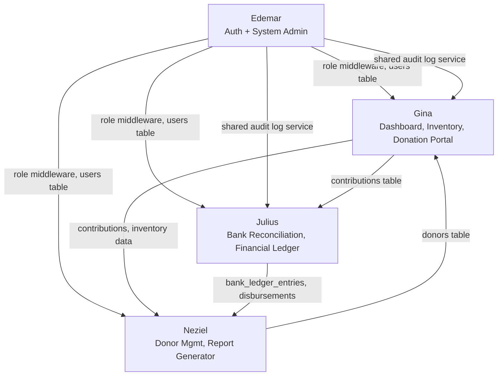

# Barangay Donation Management System
## Team Task Assignment

**Document Type:** Official Task Allocation & Defense Reference
**Status:** Living document — update checklists as tasks are completed
**Source of Truth:** [`docs/PROJECT_REQUIREMENTS.md`](./PROJECT_REQUIREMENTS.md) (Functional Requirements Specification, last reviewed 2026-08-02)
**Team:** Gina, Neziel, Julius, Edemar

---

### How to read this document

Each member section lists concrete, actionable tasks derived from the functional requirements already assigned to their modules. Tasks marked **(done)** reflect work already present in the codebase as of the last requirements review — verify before claiming credit in defense. Tasks with no marker are outstanding work needed to close the gaps identified in the requirements doc (🟡 Partially Implemented / ⏳ Planned items).

| Status Marker | Meaning |
|---|---|
| **(done)** | Implemented in the current codebase |
| *(no marker)* | Outstanding — needs to be built |

---

## Gina — Dashboard, In-Kind Inventory, Donation Portal

### Overview
Gina owns the three modules that carry the system's day-to-day operational core: the at-a-glance Dashboard, the in-kind warehouse workflow (stock-in/stock-out/monitoring), and the Donation Portal where cash and in-kind gifts are logged and verified.

### Responsibilities
- Keep the Dashboard's summary metrics accurate as new data sources (disbursements, void transactions) come online.
- Own the full lifecycle of an inventory item: creation, stock movement, alerting, and history.
- Own the full lifecycle of a contribution: intake, verification, and status tracking for both cash and in-kind gifts.

### Features
| Feature | Related Requirement(s) | Status |
|---|---|---|
| Access Main Dashboard | A10 | ✅ done |
| Process Stock-In | S7 | ✅ done |
| Process Stock-Out | S8 | ✅ done |
| Monitor Live Stock (low/critical/expiring alerts) | S9 | ✅ done |
| View Inventory Logs (movement history) | S11 | ✅ done |
| Configure Item Categories (admin-editable) | A6 | ✅ done |
| Record Cash Receipts (Donation Portal) | S5 | ✅ done |
| Record Cash Disbursements | S6 | ✅ done |

### Database Tables Used
- `inventory_items` — item master data, quantity, unit, thresholds
- `inventory_stock_movements` — stock-in/stock-out audit trail (`movement_type`, `quantity_before/after`, `reason`, `created_by`)
- `contributions` — cash and in-kind donation records (`type`, `status`, `amount`, `payment_method`, `verified_by`, `verified_at`)
- `contribution_items` — line items for in-kind contributions (links to `inventory_items`)
- `donors` — read dependency for donation intake (owned by Neziel, consumed here)
- `campaigns` — optional grouping for contributions
- `inventory_categories`, `inventory_units` — admin-managed reference data replacing `config/inventory.php` (A6)
- `cash_disbursements` — outbound cash disbursement records (`disbursed_to`, `purpose`, `amount`, `payment_method`, `disbursed_at`, `created_by`); no status/approval columns yet — reserved for Julius's A7 work (S6)

### Backend Tasks
- [ ] **(done)** `DashboardController` — aggregate stat summaries, activity feed, panel data
- [ ] **(done)** `InventoryController` — CRUD for `InventoryItem` (`index`, `store`, `show`, `update`)
- [ ] **(done)** `InventoryStockAdjustmentController` — stock-in/stock-out adjustment endpoint
- [ ] **(done)** `AdjustInventoryStock` service — quantity math, movement logging, stock-out cannot exceed available stock
- [ ] **(done)** `CreateInventoryItem` service
- [ ] **(done)** `InventoryAlertQuery` service — low/critical/out-of-stock/expiring computation
- [ ] **(done)** `DonationPortalController` — `index`, `store`, `show`, `update`, `verify`
- [ ] **(done)** `LogContribution` service — creates `Contribution` + `ContributionItem` rows
- [ ] **(done)** `InventoryItemPolicy`, `ContributionPolicy` — authorization rules
- [x] Add `inventory_categories`/`inventory_units` tables, models, policies, `ManageInventoryReferenceItem` service, and CRUD controllers/routes; update `InventoryItem` validation and search to read from the database instead of `config/inventory.php` (closes A6)
- [x] Design and build cash disbursement recording endpoint (`CashDisbursementController`, `cash_disbursements` table, `RecordCashDisbursement` service) — outbound record, distinct from inbound `contributions` (closes S6; schema deliberately excludes approval/status columns pending Julius's A7 work)
- [x] Wire dashboard widgets to reflect disbursement totals now recorded via S6 (additive `disbursements` key in `DashboardMetrics`); ready to extend once Julius's A7 approval workflow lands, without hardcoded assumptions about his schema

### Frontend Tasks
- [ ] **(done)** `dashboard.blade.php` + `components/dashboard/*` (panel, stat-list, activity-list, summary-card, empty/error states)
- [ ] **(done)** `inventory/index.blade.php`, `inventory/show.blade.php`
- [ ] **(done)** `components/inventory/*` — filter tabs, search bar, status badge, stock summary, alert panel, table/table-row, create modal, item form, adjust-stock modal
- [ ] **(done)** `donations/index.blade.php`, `donations/show.blade.php`
- [ ] **(done)** `components/donations/*` — status badge, filter bar, table/table-row, cash-fields, in-kind-fields, item-row, log-modal
- [x] Build admin-facing "Manage Item Categories" screen (add/edit/remove category + unit) to replace static config
- [x] Build "Record Disbursement" form/modal — new "Cash Disbursements" page and sidebar entry

### API Endpoints Needed
| Method | Route | Purpose | Status |
|---|---|---|---|
| GET | `/` | Dashboard | ✅ done |
| GET | `/inventory` | List inventory items | ✅ done |
| POST | `/inventory` | Create inventory item | ✅ done |
| GET | `/inventory/{inventoryItem}` | Item detail + movement history | ✅ done |
| PATCH | `/inventory/{inventoryItem}` | Update item | ✅ done |
| POST | `/inventory/{inventoryItem}/adjustments` | Stock-in/stock-out | ✅ done |
| GET | `/donations` | List contributions | ✅ done |
| POST | `/donations` | Record cash/in-kind donation | ✅ done |
| GET | `/donations/{contribution}` | Donation detail | ✅ done |
| PATCH | `/donations/{contribution}` | Update donation | ✅ done |
| PATCH | `/donations/{contribution}/verify` | Verify donation | ✅ done |
| GET/POST/PATCH/DELETE | `/inventory/categories`, `/inventory/units` | CRUD item categories/units (admin-only mutations) | ✅ done |
| GET/POST | `/cash-disbursements`, `/cash-disbursements/{cashDisbursement}` | Record and view outbound cash disbursements | ✅ done |

### Validation Rules
- Stock-out quantity must not exceed current `quantity_before` (enforced in `AdjustInventoryStock`).
- `movement_type` restricted to `stock_in` / `stock_out`; `reason` restricted to a known set (e.g., `distribution`).
- Contribution `type` restricted to `cash` / `in_kind`; `amount` required when `type = cash`; `contribution_items` required when `type = in_kind`.
- `payment_method` + `reference_number` combination must be unique per the DB constraint on `contributions`.
- Category/unit `key` must be unique and non-empty, enforced via `inventory_categories`/`inventory_units` unique constraints and Form Request validation (done).
- Disbursement amount must be positive (`min:0.01`); a balance-ceiling check against available cash was deliberately deferred — no authoritative balance source exists yet pending Julius's Financial Ledger integration.

### Dependencies
- Consumes `donors` records owned by **Neziel** (Donor Management) for donation intake.
- Feeds contribution and inventory data into **Neziel's** Report Generator (Financial Ledgers, future inventory reports).
- Feeds contribution data into **Julius's** Bank Reconciliation and Financial Ledger modules.
- Cash disbursement work must align with **Julius's** Financial Ledger schema (a disbursement is a ledger entry, not just an inventory concept).
- Relies on **Edemar's** authentication/role middleware (`role:admin,secretary,treasurer`) to gate all routes.

### Testing Checklist
- [ ] **(done)** `tests/Feature/InventoryManagementTest.php` — stock-in/out, thresholds, validation
- [ ] **(done)** `tests/Feature/DonationManagementTest.php` — cash/in-kind intake, verification flow
- [x] Add feature test for admin category management once built — `tests/Feature/InventoryCategoryManagementTest.php`
- [x] Add feature test for cash disbursement recording once built — `tests/Feature/CashDisbursementTest.php`
- [x] Add dashboard widget test asserting stat totals match underlying data — `test_dashboard_reflects_recorded_disbursement_totals`

### Documentation Required
- [ ] Inventory stock movement lifecycle diagram (stock-in → alert thresholds → stock-out)
- [ ] Donation Portal intake-to-verification flow diagram (cash vs in-kind branches)
- [ ] Dashboard widget data-source reference (which query backs each stat/panel)
- [ ] Category management admin guide — feature is built (A6); standalone how-to guide not yet written

### Deliverables
- Fully functional Dashboard reflecting live donation, inventory, and cash metrics
- In-Kind Inventory module: item CRUD, stock-in/out, live alerts, movement history
- Donation Portal: cash + in-kind intake with verification workflow
- Admin-manageable item categories (closes A6)
- Cash disbursement recording (closes S6, unblocks Julius's approval flow A7)

### Estimated Priority
- **Critical:** Donation Portal (S5), Stock-In/Stock-Out (S7/S8), Dashboard (A10)
- **High:** Monitor Live Stock (S9), Cash Disbursements (S6)
- **Medium:** Configure Item Categories (A6)

### Completion Checklist
- [x] Dashboard summary widgets
- [x] Inventory item CRUD
- [x] Stock-in / stock-out adjustment flow
- [x] Live stock alerts (low/critical/expiring)
- [x] Inventory movement history view
- [x] Donation Portal cash intake
- [x] Donation Portal in-kind intake
- [x] Donation verification workflow
- [x] Admin-managed item categories/units (A6)
- [x] Cash disbursement recording (S6)
- [x] Dashboard widgets updated for disbursement data
- [x] New feature tests for above

---

## Neziel — Donation Management, Report Generator

### Overview
Neziel owns donor-facing records (the "who" behind every donation) and the reporting layer that turns raw contribution/inventory/ledger data into structured, exportable reports for the Administrator.

### Responsibilities
- Maintain accurate, searchable donor records and donation history.
- Build and extend the Report Generator: report types, filters, and export formats.

### Features
| Feature | Related Requirement(s) | Status |
|---|---|---|
| Manage Donor Records (create/view/update) | A5 | ✅ done |
| Search Donor Database | S3 | ✅ done |
| View Donor Profiles + history | S4 | ✅ done |
| Generate Financial Reports (Financial Ledgers) | A11 | ✅ done |
| View Cash Ledger Logs | S10 | ✅ done |
| CSV Export | (supports A11) | ✅ done |
| Export PDF Files | A12 | ⏳ outstanding |
| Download PDF Reports (Staff) | S12 | ⏳ outstanding |
| Additional report types (donor giving summary, inventory valuation) | Future Enhancements | ⏳ outstanding |

### Database Tables Used
- `donors` — donor master data (individuals/organizations)
- `contributions` / `contribution_items` — read dependency for donation history and Financial Ledgers report
- `campaigns` — optional grouping context
- `bank_ledger_entries` — read dependency (Julius's module) for ledger-based reports

### Backend Tasks
- [ ] **(done)** `DonorController` — `index` (with search), `store`, `show`, `update`
- [ ] **(done)** `FinancialLedgerReportBuilder` service — assembles ledger data filterable by year/month
- [ ] **(done)** `FinancialLedgerCsvExporter` service
- [ ] **(done)** `ReportController` — `index`, `financialLedgersCsv`
- [ ] Add PDF export capability: introduce a PDF rendering library (e.g., `barryvdh/laravel-dompdf`) to `composer.json`
- [ ] Build `FinancialLedgerPdfExporter` (or generalized `ReportPdfExporter`) mirroring the CSV exporter's structure
- [ ] Add `ReportController::financialLedgersPdf` (or generic `{report}/pdf`) endpoint
- [ ] Design and build at least one additional report builder (e.g., Donor Giving Summary) following the `FinancialLedgerReportBuilder` pattern
- [ ] Add donor deduplication/merge safeguard (validation-level, not full feature) if duplicate donor entries are a defense concern

### Frontend Tasks
- [ ] **(done)** `donors/index.blade.php`, `donors/show.blade.php`
- [ ] **(done)** `components/donors/*` — search-bar, form, create-modal, edit-modal, card, history-summary
- [ ] **(done)** `reports/index.blade.php`
- [ ] **(done)** `components/reports/*` — tab-nav, month-filter, wire-source-bar, ledger-row
- [ ] Add "Download PDF" button/action to the Report Generator UI (Financial Ledgers tab)
- [ ] Add new tab(s) to `reports/index.blade.php` for each new report type
- [ ] Surface donor giving history totals on `donors/show.blade.php` if not already summarized

### API Endpoints Needed
| Method | Route | Purpose | Status |
|---|---|---|---|
| GET | `/donors` | List/search donors | ✅ done |
| POST | `/donors` | Create donor | ✅ done |
| GET | `/donors/{donor}` | Donor profile + history | ✅ done |
| PATCH | `/donors/{donor}` | Update donor | ✅ done |
| GET | `/reports` | Report Generator index | ✅ done |
| GET | `/reports/financial-ledgers/csv` | CSV export | ✅ done |
| GET | `/reports/financial-ledgers/pdf` (new) | PDF export | outstanding |
| GET | `/reports/{report-type}` (new) | Additional report types | outstanding |

### Validation Rules
- Donor name required; contact fields validated per format (email/phone) if collected.
- Donor `payment_method` + `reference_number` referenced from `contributions` must satisfy the existing unique constraint.
- Report filters: year/month must resolve to a valid date range; reject empty result sets gracefully (empty state, not error).
- PDF export: reuse the same filtered dataset as the CSV export to guarantee parity between formats.

### Dependencies
- Donor records are a prerequisite for **Gina's** Donation Portal (a contribution always references a `donor_id`).
- Financial Ledgers report reads `contributions` (Gina), `bank_ledger_entries` (Julius), so timing of those modules affects report completeness.
- PDF export is a shared capability also needed by **Julius** (Financial Ledger/Bank Reconciliation reports) — coordinate the library choice and exporter interface once, reuse across both.
- Relies on **Edemar's** role middleware for route access.

### Testing Checklist
- [ ] **(done)** `tests/Feature/FinancialLedgerReportBuilderTest.php`
- [ ] **(done)** `tests/Feature/ReportGeneratorTest.php`
- [ ] Add donor CRUD/search feature test if not already covered
- [ ] Add PDF export feature test once built (assert content-type, byte signature, and row parity with CSV)
- [ ] Add feature test for each new report type

### Documentation Required
- [ ] Donor data model reference (fields, relationships to contributions)
- [ ] Report Generator architecture doc (builder → exporter pattern, how to add a new report type)
- [ ] PDF export setup notes (library, fonts, layout constraints)

### Deliverables
- Donor Management: full CRUD, search, profile with donation history
- Report Generator: Financial Ledgers report with CSV export (done); PDF export (outstanding); at least one additional report type (outstanding)

### Estimated Priority
- **Critical:** Manage Donor Records (A5), Generate Financial Reports (A11)
- **High:** Search/View Donor Profiles (S3/S4)
- **Medium:** View Cash Ledger Logs (S10), PDF Export (A12/S12), additional report types

### Completion Checklist
- [x] Donor CRUD (create/view/update)
- [x] Donor search
- [x] Donor profile with contribution history
- [x] Financial Ledgers report builder
- [x] CSV export
- [ ] PDF export library integration
- [ ] Financial Ledgers PDF export (A12/S12)
- [ ] At least one additional report type
- [ ] Feature tests for PDF export and new report types

---

## Julius — Bank Reconciliation, Financial Ledger

### Overview
Julius owns the financial control layer: matching bank statement entries against recorded donations, and (going forward) the full cash bookkeeping lifecycle including disbursements, approvals, and void/reversal with audit trail.

### Responsibilities
- Keep the reconciliation process accurate and auditable (match, mark reconciled, track status).
- Extend cash bookkeeping beyond inbound-only: disbursements, approval workflow, void/reversal.

### Features
| Feature | Related Requirement(s) | Status |
|---|---|---|
| Reconcile Cash Ledger | A8 | ✅ done |
| View Cash Ledger Logs (ledger entry listings) | S10 (shared with Neziel's report view) | ✅ done |
| Approve Fund Disbursements | A7 | ⏳ outstanding |
| Void Cash Transactions | A9 | ⏳ outstanding |
| Record Cash Disbursements (schema/ledger side) | S6 (UI/entry owned by Gina) | ⏳ outstanding |

### Database Tables Used
- `bank_ledger_entries` — imported/recorded bank statement lines (`status`, `matched_contribution_id`, `matched_by`, `matched_at`)
- `contributions` — matched against ledger entries (owned/populated by Gina's Donation Portal)
- New (outstanding): a disbursement/approval table (e.g., `cash_disbursements`) and a void/reversal audit table or status column on `contributions`/`cash_disbursements`

### Backend Tasks
- [ ] **(done)** `BankReconciliationController` — `index`, `reconcile`
- [ ] **(done)** `LedgerMatchFinder` service — candidate matching logic
- [ ] **(done)** `ReconcileLedgerEntry` service — marks entry reconciled, links to contribution
- [ ] **(done)** `LedgerChannelResolver` service — payment channel resolution
- [ ] **(done)** `BankLedgerEntryPolicy` — authorization
- [ ] Design `cash_disbursements` migration (`amount`, `purpose`, `requested_by`, `approved_by`, `status`, `approved_at`)
- [ ] Build `DisbursementController` (or extend an existing cash controller) — `store` (request), `approve`, `reject`
- [ ] Build `ApproveDisbursement` service enforcing maker-checker (requester ≠ approver)
- [ ] Design void/reversal mechanism: add `voided_at`, `voided_by`, `void_reason` columns (soft state, no hard deletes) to `contributions` and/or `cash_disbursements`
- [ ] Build `VoidCashTransaction` service — reverses ledger effect while preserving original record and writing an audit trail entry
- [ ] Extend `SecurityActivityEvent` logging (or a dedicated audit log) to capture disbursement approvals and void actions

### Frontend Tasks
- [ ] **(done)** `bank-reconciliation.blade.php`
- [ ] **(done)** `components/bank-reconciliation/*` — badge, receipt-card, match-modal, audit-banner, ledger-entry
- [ ] Build "Fund Disbursements" page: request list, approve/reject actions, status badges
- [ ] Build "Void Transaction" action (button + confirmation modal) on contribution/disbursement detail views
- [ ] Surface void/disbursement history on the Financial Ledgers report view (coordinate with Neziel)

### API Endpoints Needed
| Method | Route | Purpose | Status |
|---|---|---|---|
| GET | `/bank-reconciliation` | List ledger entries + match candidates | ✅ done |
| POST | `/bank-reconciliation/reconcile` | Reconcile a ledger entry | ✅ done |
| POST | `/disbursements` (new) | Request a cash disbursement | outstanding |
| PATCH | `/disbursements/{disbursement}/approve` (new) | Approve disbursement | outstanding |
| PATCH | `/disbursements/{disbursement}/reject` (new) | Reject disbursement | outstanding |
| PATCH | `/contributions/{contribution}/void` (new) | Void a cash transaction | outstanding |

### Validation Rules
- A `bank_ledger_entries` row can match at most one `contribution` (existing unique constraint on `matched_contribution_id`).
- Reconciliation requires `status = unmatched` before allowing a match action.
- New: disbursement amount must be positive and requires a `purpose`; approver must have `admin` role and cannot equal the requester.
- New: void action requires a `void_reason`; only unreconciled/unverified transactions (or explicitly permitted states) may be voided — define exact rule with Gina/Neziel since it affects report totals.
- New: voided transactions must be excluded from active balance calculations but retained in audit history.

### Dependencies
- Reconciliation depends on `contributions` created by **Gina's** Donation Portal.
- Disbursement and void data feed directly into **Neziel's** Financial Ledgers report — report builder must be updated once these tables exist.
- Void/disbursement actions must be logged through **Edemar's** audit log infrastructure (`SecurityActivityEvent` or equivalent) for consistency with system-wide audit trail.
- Cash disbursement UI entry point (S6) is owned by **Gina**; Julius owns the underlying ledger/approval schema and logic — align on the data contract early.

### Testing Checklist
- [ ] **(done)** `tests/Feature/BankReconciliationTest.php`
- [ ] Add feature test for disbursement request + approval flow (maker-checker enforcement)
- [ ] Add feature test for void/reversal preserving audit trail and excluding voided entries from balances
- [ ] Add regression test confirming Financial Ledgers report totals correctly reflect disbursements and voids once built

### Documentation Required
- [ ] Reconciliation matching algorithm reference (how `LedgerMatchFinder` scores candidates)
- [ ] Disbursement approval workflow diagram (maker-checker states)
- [ ] Void/reversal policy doc — what can be voided, by whom, and audit trail guarantees

### Deliverables
- Bank Reconciliation: ledger import/listing, match-and-reconcile flow
- Fund Disbursement: request + approval workflow (closes A7)
- Void/Reversal: audit-preserving cash transaction voiding (closes A9)
- Updated Financial Ledger data model reflecting disbursements and voids

### Estimated Priority
- **Critical:** Reconcile Cash Ledger (A8)
- **High:** Approve Fund Disbursements (A7), Void Cash Transactions (A9)
- **Medium:** View Cash Ledger Logs (S10, shared)

### Completion Checklist
- [x] Bank ledger entry listing
- [x] Ledger-to-contribution matching
- [x] Reconciliation status tracking
- [x] Audit banner in reconciliation UI
- [ ] `cash_disbursements` schema + migration
- [ ] Disbursement request + approval workflow (A7)
- [ ] Void/reversal mechanism with audit trail (A9)
- [ ] Financial Ledgers report updated for disbursements/voids
- [ ] Feature tests for disbursement and void flows

---

## Edemar — Authentication (Sign In / Sign Up / Sign Out), System Administration

### Overview
Edemar owns the security perimeter of the system: authentication, session handling, role-based authorization, and the administrative tooling for managing staff accounts and auditing security-relevant activity.

### Responsibilities
- Ensure login/logout/registration are secure and correctly scoped by role.
- Close the gap between "view-only" staff administration and full account lifecycle management.
- Maintain the audit log and 2FA enforcement tooling.

### Features
| Feature | Related Requirement(s) | Status |
|---|---|---|
| Log In | A1 / S1 | ✅ done |
| Log Out | A2 / S2 | ✅ done |
| Audit System Logs | A4 | ✅ done |
| Manage Staff Accounts (view + 2FA toggle) | A3 | 🟡 partial |
| Manage Staff Accounts (full create/edit/deactivate CRUD) | A3 | ⏳ outstanding |

### Database Tables Used
- `users` — credentials, `first_name`, `last_name`, `status`, `last_login_at`, `role_id`
- `roles` — `admin`, `secretary`, `treasurer` (name, display_name, description)
- `security_permissions`, `security_permission_user` — granular permission grants
- `user_security_profiles` — 2FA enabled/enforced state, verification timestamp
- `security_activity_events` — audit log (actor, action, summary, metadata, IP, occurred_at)

### Backend Tasks
- [ ] **(done)** `Auth\AuthenticatedSessionController` — `create`, `store` (login), `destroy` (logout)
- [ ] **(done)** `Auth\RegisteredUserController` — `create`, `store` (self-service registration)
- [ ] **(done)** `role:admin,secretary,treasurer` route middleware
- [ ] **(done)** `SystemSecurityController` — `index`, `updateTwoFactorEnforcement`
- [ ] **(done)** `SystemSecurityDashboardQuery` service — personnel list, activity log query/filter
- [ ] **(done)** `ToggleTwoFactorEnforcement` service
- [ ] **(done)** `SecurityActivityEventPolicy`
- [ ] Build `StaffAccountController` (or extend `SystemSecurityController`) — `store` (create staff account with role assignment), `update` (edit name/role/email), `deactivate` (soft-disable, sets `status`)
- [ ] Build `CreateStaffAccount` / `UpdateStaffAccount` / `DeactivateStaffAccount` services following existing service-class pattern
- [ ] Gate account creation/edit/deactivation behind `admin`-only authorization (extend or add a policy)
- [ ] Ensure every account lifecycle action (create/edit/deactivate) writes a `security_activity_events` row for auditability
- [ ] Review self-service `/register` — confirm whether it should remain open or be restricted once admin-driven account creation exists (scope decision, flag for defense Q&A)

### Frontend Tasks
- [ ] **(done)** `auth/login.blade.php`, `auth/register.blade.php`, `layouts/guest.blade.php`
- [ ] **(done)** `system-security.blade.php`
- [ ] **(done)** `components/system-security/*` — status-badge, section-header, permission-checklist, filter-dropdown, search-bar, activity-log-row, user-security-card
- [ ] Build "Create Staff Account" modal/form (name, email, role selection, initial password/invite flow)
- [ ] Build "Edit Staff Account" modal (name, role, status)
- [ ] Build "Deactivate Account" confirmation action + disabled-state styling on `user-security-card`
- [ ] Add role/permission assignment UI if per-user granular permissions (`security_permissions`) are to be admin-editable

### API Endpoints Needed
| Method | Route | Purpose | Status |
|---|---|---|---|
| GET/POST | `/login` | Login form + submit | ✅ done |
| GET/POST | `/register` | Registration form + submit | ✅ done |
| POST | `/logout` | Logout | ✅ done |
| GET | `/system-security` | Security dashboard (personnel + audit log) | ✅ done |
| PATCH | `/system-security/users/{user}/two-factor-enforcement` | Toggle 2FA enforcement | ✅ done |
| POST | `/system-security/users` (new) | Create staff account | outstanding |
| PATCH | `/system-security/users/{user}` (new) | Edit staff account | outstanding |
| PATCH | `/system-security/users/{user}/deactivate` (new) | Deactivate staff account | outstanding |

### Validation Rules
- Login: valid email + password required; rate-limit/lockout on repeated failures (verify existing throttle behavior).
- Registration: unique email, password confirmation, minimum complexity per Laravel defaults.
- New staff account creation: unique email, valid `role_id` (must be one of `admin`/`secretary`/`treasurer`), required first/last name.
- Deactivation: cannot deactivate the last remaining `admin` account (safeguard against lockout).
- Role changes and deactivation must be `admin`-only actions, enforced server-side (not just hidden in UI).

### Dependencies
- Every other module (`role:admin,secretary,treasurer` middleware) depends on Edemar's authentication and role system being correct — **this module should be stabilized first / integrated earliest**.
- Audit logging (`security_activity_events`) is a shared resource: **Julius's** disbursement approvals and void actions, and **Gina's** cash disbursement recording, should log through this same table/service rather than inventing a parallel log.
- Staff account management affects who can perform actions in every other module (e.g., `verified_by`, `created_by`, `matched_by`, `granted_by` foreign keys all reference `users`).

### Testing Checklist
- [ ] **(done)** `tests/Feature/Auth/RegistrationTest.php`
- [ ] **(done)** `tests/Feature/SystemSecurityAdministrationTest.php`
- [ ] Add login/logout feature test if not already covered under an existing auth test
- [ ] Add feature test for staff account creation (admin-only, role assignment)
- [ ] Add feature test for staff account edit and deactivation, including the "last admin" safeguard
- [ ] Add feature test asserting non-admin roles cannot access account management endpoints

### Documentation Required
- [ ] Authentication flow diagram (login → role-based redirect → protected routes)
- [ ] Role/permission model reference (`roles`, `security_permissions`, `security_permission_user`)
- [ ] Staff account lifecycle guide (create → 2FA enforcement → deactivate)
- [ ] Audit log schema reference (`action` taxonomy, `metadata` shape) — shared reference for Gina/Julius when logging new actions

### Deliverables
- Authentication: login, logout, registration (done)
- System Security dashboard: personnel view, 2FA enforcement toggle, audit log search/filter (done)
- Full staff account lifecycle: create, edit, deactivate (closes A3)
- Documented, shared audit-logging contract for use by other modules

### Estimated Priority
- **Critical:** Log In / Log Out (A1/A2/S1/S2)
- **High:** Manage Staff Accounts full CRUD (A3), Audit System Logs (A4)
- **Medium:** Granular permission assignment UI (if pursued beyond current scope)

### Completion Checklist
- [x] Login flow with role-based redirect
- [x] Logout flow
- [x] Self-service registration
- [x] Role middleware (`admin`, `secretary`, `treasurer`)
- [x] Security dashboard — personnel list
- [x] Security dashboard — audit log search/filter
- [x] 2FA enforcement toggle
- [ ] Staff account creation (admin UI)
- [ ] Staff account editing (admin UI)
- [ ] Staff account deactivation (admin UI)
- [ ] "Last admin" deactivation safeguard
- [ ] Feature tests for full account lifecycle

---

# Project Integration Plan

### How the work connects

### Shared Database Tables
| Table | Owner | Consumed By |
|---|---|---|
| `users`, `roles` | Edemar | All modules (every FK `created_by`, `verified_by`, `matched_by`, `granted_by`, `actor_id`) |
| `security_activity_events` | Edemar | Julius (disbursement/void logging), Gina (disbursement logging) |
| `donors` | Neziel | Gina (Donation Portal intake) |
| `contributions` / `contribution_items` | Gina | Julius (reconciliation), Neziel (reports) |
| `inventory_items` / `inventory_stock_movements` | Gina | Neziel (future inventory reports) |
| `bank_ledger_entries` | Julius | Neziel (Financial Ledgers report) |
| `cash_disbursements` *(new)* | Julius (schema/approval) + Gina (entry UI) | Neziel (reports) |

### API Dependencies
- All protected routes depend on Edemar's `auth` + `role:admin,secretary,treasurer` middleware group in `routes/web.php`.
- Neziel's Financial Ledgers report (`ReportController`) reads from Gina's `contributions` and Julius's `bank_ledger_entries` — report accuracy is blocked on both modules staying schema-compatible.
- Gina's future disbursement entry endpoint must write to the `cash_disbursements` schema Julius designs — this is the tightest cross-member coupling in the plan and should be scoped together before either side starts coding.

### Module Dependencies
1. **Edemar's** auth/role system is a hard prerequisite for every other module (nothing behind the middleware works without it) — already done, but staff account CRUD should land early since it affects who can be a `verified_by`/`matched_by`/`approved_by` actor in demos and tests.
2. **Neziel's** donor records are a hard prerequisite for **Gina's** donation intake (a contribution cannot be created without a `donor_id`).
3. **Gina's** contributions/inventory are a hard prerequisite for **Julius's** reconciliation and **Neziel's** reports.
4. **Julius's** ledger/disbursement data is a hard prerequisite for **Neziel's** complete Financial Ledgers report.

### Integration Order
1. Edemar — confirm auth/role foundation stable (already largely done); prioritize staff account CRUD next since other members' audit trails reference `users`.
2. Neziel — donor management (already done) unblocks Gina's donation intake testing.
3. Gina — inventory + donation portal (already done); coordinate disbursement entry UI with Julius before building.
4. Julius — reconciliation (already done); design `cash_disbursements` schema and share it with Gina before either builds against it.
5. Neziel — extend Financial Ledgers report + add PDF export once Julius's disbursement/void data exists; add new report types last.
6. All — final cross-module regression pass (see checklist below) before defense.

### Possible Merge Conflicts
- **`routes/web.php`** — every member adds routes here (new disbursement, category, staff-account, PDF-export endpoints). Coordinate route additions in small, frequent PRs to avoid conflicting inserts in the same middleware group.
- **`FinancialLedgerReportBuilder`** — both Julius (new disbursement/void data) and Neziel (new report types/PDF export) will touch this service; sequence Julius's schema changes before Neziel rebuilds the report query.
- **`config/inventory.php`** → migrating to a DB-backed category table (Gina) will touch any other code that currently reads the static config (check `InventoryController`, `AdjustInventoryStock`, and inventory-related tests).
- **`SecurityActivityEvent` logging** — if Gina and Julius both start writing audit entries independently, agree on the `action` string taxonomy with Edemar first to avoid inconsistent/duplicate log formats.
- **Shared Blade components** (`components/dashboard/*`, layout files) — if two members touch the same panel/layout in parallel, resolve via small PRs and clear component ownership (Gina owns dashboard components).

### Recommended Git Branching Strategy
- `main` — stable, defense-ready branch. Protected; only merges via reviewed PRs.
- One feature branch per outstanding task, prefixed by owner and module, e.g.:
  - `gina/inventory-categories-admin-ui`
  - `gina/cash-disbursement-entry`
  - `neziel/report-pdf-export`
  - `neziel/report-donor-summary`
  - `julius/cash-disbursements-schema`
  - `julius/disbursement-approval-flow`
  - `julius/void-cash-transaction`
  - `edemar/staff-account-crud`
- Branch from `main`, keep branches short-lived (target: mergeable within a few days), rebase on `main` before opening a PR to minimize conflicts in `routes/web.php` and shared services.
- Cross-cutting work (e.g., `cash_disbursements` schema) should land as its own small branch/PR first, merged to `main`, so both Julius and Gina branch from the same schema instead of duplicating migrations.
- Require at least one teammate review before merging to `main`, especially for shared files (`routes/web.php`, `FinancialLedgerReportBuilder`, `SecurityActivityEvent` usage).

### Final Integration Checklist
- [ ] All outstanding ⏳/🟡 requirements from `PROJECT_REQUIREMENTS.md` re-verified against the codebase
- [ ] `cash_disbursements` schema agreed and migrated (Julius + Gina)
- [ ] Disbursement approval flow (A7) functional end-to-end: request (Gina UI) → approve (Julius backend) → reflected in report (Neziel)
- [ ] Void/reversal flow (A9) functional end-to-end and excluded from active balances but visible in audit history
- [ ] Staff account full CRUD (A3) functional and admin-gated (Edemar)
- [ ] PDF export functional for at least the Financial Ledgers report (A12/S12) (Neziel)
- [ ] Admin-managed item categories functional (A6) (Gina)
- [ ] All new endpoints covered by feature tests; full `tests/Feature` suite passes
- [ ] Audit log (`security_activity_events`) captures all new sensitive actions (disbursement approval, void, staff account changes)
- [ ] Full demo path re-walked end-to-end: Log in → Dashboard → Create donor → Record donation → Verify → Stock-in/out → Reconcile → Request/approve disbursement → Void a transaction → Generate report → Export CSV/PDF → Manage staff account
- [ ] `docs/PROJECT_REQUIREMENTS.md` status column updated to match final implementation state before defense
