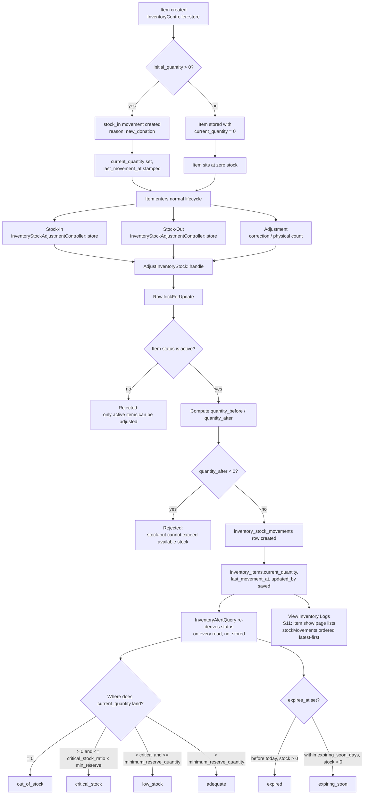

# Inventory Stock Movement Lifecycle

**Module:** In-Kind Inventory (Gina)
**Related Requirements:** S7 (Stock-In), S8 (Stock-Out), S9 (Monitor Live Stock), S11 (Inventory Logs)
**Source of truth:** `App\Services\Inventory\CreateInventoryItem`, `App\Services\Inventory\AdjustInventoryStock`, `App\Services\Inventory\InventoryAlertQuery`

## Overview

Every inventory item carries a live `current_quantity` on `inventory_items`, plus an append-only audit trail in `inventory_stock_movements`. The two are always updated together, inside the same database transaction, so the item's quantity can never drift from its movement history.

## Lifecycle Diagram

## Stages

### 1. Item creation (`CreateInventoryItem`)
- Runs in a `DB::transaction`.
- Sets `current_quantity` from `initial_quantity` and `status` from `config('inventory.defaults.status')` (`active`) unless overridden.
- If `initial_quantity > 0`, immediately writes one `stock_in` movement (`reason: new_donation`) so the item never has quantity without a matching audit row.

### 2. Stock-In / Stock-Out / Adjustment (`AdjustInventoryStock`)
- Route: `POST /inventory/{inventoryItem}/adjustments` (`inventory.adjustments.store`).
- Locks the item row (`lockForUpdate()`) to prevent race conditions from concurrent adjustments.
- Refuses to adjust an item that is not `active` (inactive/archived items are frozen).
- `movement_type` drives the math:
  - `stock_in` → `quantity_before + quantity`
  - `stock_out` → `quantity_before - quantity`
  - `adjustment` → `quantity_before + quantity` (signed delta)
- Rejects any result below zero (`ValidationException` on `quantity`) — this is the enforcement point for S8's "stock-out cannot exceed available stock" rule.
- Writes the `inventory_stock_movements` row and the updated `inventory_items` row in the same transaction.

### 3. Alert thresholds (`InventoryAlertQuery`)
Stock status is **never stored** — it's computed fresh from `current_quantity`, `minimum_reserve_quantity`, and `config('inventory.critical_stock_ratio')` (`0.25`) each time the dashboard/alert panel is read:

| Status | Condition |
|---|---|
| `out_of_stock` | `current_quantity = 0` |
| `critical_stock` | `0 < current_quantity <= minimum_reserve_quantity * 0.25` |
| `low_stock` | `minimum_reserve_quantity * 0.25 < current_quantity <= minimum_reserve_quantity` |
| `adequate` | `current_quantity > minimum_reserve_quantity` |
| `expired` | `expires_at` in the past and `current_quantity > 0` |
| `expiring_soon` | `expires_at` within `config('inventory.expiring_soon_days')` (`30` days) and `current_quantity > 0` |

Each alert group is capped by `config('inventory.alerts.limit')` (`5`) and queried independently so one slow/empty group never blocks the others.

### 4. Inventory Logs (S11)
The item detail page (`inventory.show`) loads the item's `stockMovements` relationship ordered newest-first — this is the movement history view referenced in S11. Movements are immutable; corrections are made by creating a new `adjustment` movement rather than editing history.

## Key Invariant

> `inventory_items.current_quantity` at any point in time equals the running sum of every `inventory_stock_movements.quantity_after` value for that item, because both are only ever written together inside `AdjustInventoryStock` / `CreateInventoryItem`'s transactions.
